# QuizGuard — TÀI LIỆU PHÂN TÍCH & THIẾT KẾ HỆ THỐNG

> **Tên đề tài:** QuizGuard – Hệ thống tạo đề thi trắc nghiệm tự động từ tài liệu và giám sát thi trực tuyến  
> **Môn học:** IT4409 – Công nghệ Web và Dịch vụ trực tuyến (SOICT – HUST)  
> **Phiên bản tài liệu:** v1.0 · 11/2026

---

## MỤC LỤC

1. [Bối cảnh](#1-bối-cảnh)
2. [Thực trạng và vấn đề](#2-thực-trạng-và-vấn-đề)
3. [Khảo sát các giải pháp hiện có](#3-khảo-sát-các-giải-pháp-hiện-có)
4. [Phân tích nhu cầu](#4-phân-tích-nhu-cầu)
5. [Mục tiêu, phạm vi và giải pháp đề xuất](#5-mục-tiêu-phạm-vi-và-giải-pháp-đề-xuất)
6. [Tác nhân và Use Case](#6-tác-nhân-và-use-case)
7. [Yêu cầu chức năng chi tiết](#7-yêu-cầu-chức-năng-chi-tiết)
8. [Yêu cầu phi chức năng](#8-yêu-cầu-phi-chức-năng)
9. [Quy tắc nghiệp vụ](#9-quy-tắc-nghiệp-vụ)
10. [Định nghĩa MVP](#10-định-nghĩa-mvp)
11. [Sơ đồ phân rã chức năng (BFD)](#11-sơ-đồ-phân-rã-chức-năng-bfd)
12. [Sơ đồ màn hình (Sitemap & Screen Flow)](#12-sơ-đồ-màn-hình-sitemap--screen-flow)
13. [Đặc tả màn hình & Wireframe](#13-đặc-tả-màn-hình--wireframe)
14. [Luồng nghiệp vụ chi tiết (Sequence Diagram)](#14-luồng-nghiệp-vụ-chi-tiết-sequence-diagram)
15. [Sơ đồ trạng thái](#15-sơ-đồ-trạng-thái)
16. [Thiết kế cơ sở dữ liệu (ERD)](#16-thiết-kế-cơ-sở-dữ-liệu-erd)
17. [Thiết kế API & Socket Events](#17-thiết-kế-api--socket-events)
18. [Kiến trúc hệ thống & Công nghệ](#18-kiến-trúc-hệ-thống--công-nghệ)
19. [Phân công & Lộ trình triển khai](#19-phân-công--lộ-trình-triển-khai)
20. [Rủi ro & Phương án xử lý](#20-rủi-ro--phương-án-xử-lý)
21. [Kịch bản Demo bảo vệ](#21-kịch-bản-demo-bảo-vệ)

---

## 1. BỐI CẢNH

### 1.1. Chuyển đổi số trong giáo dục đại học
- Sau giai đoạn COVID-19 (2020–2022), hình thức **dạy – học – kiểm tra trực tuyến** không còn là giải pháp tình thế mà đã trở thành một phần cố định trong mô hình đào tạo kết hợp (*blended learning*) của các trường đại học.
- Bộ GD&ĐT ban hành các văn bản cho phép tổ chức **kiểm tra, đánh giá trực tuyến** (Thông tư 08/2021/TT-BGDĐT về đào tạo đại học, cho phép một phần học phần dạy và đánh giá online).
- Các trường lớn như ĐHBK Hà Nội đã có hệ thống LMS, Teams, và thường xuyên tổ chức **quiz giữa kỳ, kiểm tra 15 phút, bài tập trắc nghiệm** trực tuyến.

### 1.2. Sự bùng nổ của AI tạo sinh (Generative AI)
- Các mô hình ngôn ngữ lớn (Gemini, GPT, Claude…) có khả năng **đọc hiểu tài liệu và sinh câu hỏi trắc nghiệm** với chất lượng chấp nhận được, mở ra cơ hội giảm mạnh thời gian soạn đề của giảng viên.
- Đồng thời, AI cũng khiến **gian lận dễ dàng hơn**: sinh viên có thể mở tab khác, copy câu hỏi vào ChatGPT và nhận đáp án trong vài giây.

### 1.3. Trình duyệt hiện đại cung cấp API giám sát
- Các trình duyệt hiện nay hỗ trợ sẵn **Page Visibility API** (`visibilitychange`), **Fullscreen API**, sự kiện `blur/focus`, `copy/paste`, `contextmenu`… cho phép phát hiện hành vi rời khỏi trang thi **mà không cần cài phần mềm** (không cần Safe Exam Browser, không cần webcam).

> [!NOTE]
> **Dẫn dắt:** Bối cảnh trên tạo ra một nghịch lý: *thi trực tuyến ngày càng phổ biến*, *soạn đề vẫn tốn công*, và *gian lận ngày càng dễ*. Đây chính là khoảng trống mà QuizGuard hướng tới.

---

## 2. THỰC TRẠNG VÀ VẤN ĐỀ

### 2.1. Phía Giảng viên

| # | Vấn đề | Mô tả thực tế | Hệ quả |
|---|---|---|---|
| P1 | **Soạn đề tốn thời gian** | Một đề 30 câu chất lượng mất 2–4 giờ: đọc lại slide, viết câu hỏi, viết 4 phương án nhiễu hợp lý. | Giảng viên ngại tổ chức kiểm tra thường xuyên; đề bị dùng lại nhiều năm → lộ đề. |
| P2 | **Khó phát hiện gian lận** | Google Forms/Teams không biết sinh viên có rời trang hay không. | Điểm số không phản ánh năng lực thật, mất công bằng. |
| P3 | **Thống kê thủ công** | Phải tải file Excel, tự vẽ biểu đồ phổ điểm, tự tính câu nào nhiều người sai. | Không có dữ liệu để điều chỉnh bài giảng. |
| P4 | **Quản lý phòng thi rời rạc** | Gửi link qua nhóm chat, không kiểm soát ai vào, vào lúc nào. | Người ngoài lớp có thể vào thi hộ; khó điểm danh. |

### 2.2. Phía Sinh viên

| # | Vấn đề | Mô tả thực tế |
|---|---|---|
| P5 | **Mất bài khi rớt mạng / F5** | Form chưa submit thì mất hết đáp án. |
| P6 | **Đồng hồ không công bằng** | Đồng hồ chạy ở client, đổi giờ máy hoặc tải lại trang có thể sai lệch thời gian. |
| P7 | **Không biết kết quả chi tiết** | Chỉ biết điểm tổng, không biết sai câu nào, vì sao sai. |

### 2.3. Phía Nhà trường / Bộ môn
- Không có **bằng chứng (log)** khi xử lý khiếu nại gian lận.
- Không có kho câu hỏi tập trung, tái sử dụng được giữa các giảng viên cùng học phần.

### 2.4. Phát biểu bài toán (Problem Statement)

> **Giảng viên đại học** cần một công cụ để **nhanh chóng tạo đề trắc nghiệm từ tài liệu bài giảng có sẵn** và **tổ chức thi trực tuyến có giám sát hành vi**, bởi vì các công cụ hiện tại **không hỗ trợ sinh đề tự động** và **không phát hiện được việc thí sinh rời khỏi màn hình thi**, dẫn đến **tốn thời gian soạn đề** và **kết quả thi thiếu tin cậy**.

---

## 3. KHẢO SÁT CÁC GIẢI PHÁP HIỆN CÓ

| Tiêu chí | Google Forms | Microsoft Forms | Kahoot / Quizizz | Moodle Quiz | Azota | **QuizGuard (đề xuất)** |
|---|:---:|:---:|:---:|:---:|:---:|:---:|
| Sinh câu hỏi bằng AI từ file PDF/Word | ❌ | ⚠️ (hạn chế) | ⚠️ (trả phí) | ❌ | ⚠️ | ✅ |
| Phòng thi theo mã PIN | ❌ | ❌ | ✅ | ❌ | ✅ | ✅ |
| Phát hiện chuyển tab / thoát fullscreen | ❌ | ❌ | ❌ | ⚠️ (plugin) | ⚠️ | ✅ |
| Giám sát thời gian thực cho giám thị | ❌ | ❌ | ⚠️ | ❌ | ❌ | ✅ |
| Đồng hồ đồng bộ server, chống F5 | ❌ | ❌ | ✅ | ✅ | ✅ | ✅ |
| Tự động lưu đáp án (autosave) | ❌ | ❌ | ✅ | ✅ | ✅ | ✅ |
| Phổ điểm & phân tích độ khó câu hỏi | ⚠️ | ⚠️ | ⚠️ | ✅ | ⚠️ | ✅ |
| Miễn phí, không cần cài đặt | ✅ | ✅ | ⚠️ | ⚠️ (cần server) | ⚠️ | ✅ |

**Kết luận khảo sát:** Chưa có công cụ phổ biến nào **kết hợp đồng thời 3 năng lực**: *(1) sinh đề AI từ tài liệu*, *(2) phòng thi PIN có giám sát hành vi thời gian thực*, *(3) phân tích kết quả*. Đây là **điểm khác biệt cốt lõi** của QuizGuard.

---

## 4. PHÂN TÍCH NHU CẦU

### 4.1. Các bên liên quan (Stakeholders)

| Bên liên quan | Vai trò | Mối quan tâm chính |
|---|---|---|
| Giảng viên (Teacher) | Người dùng chính | Tạo đề nhanh, thi công bằng, xem thống kê |
| Sinh viên (Student) | Người dùng chính | Giao diện dễ dùng, không mất bài, biết kết quả |
| Quản trị viên (Admin) | Vận hành | Quản lý tài khoản, giám sát hệ thống |
| Bộ môn / Nhà trường | Gián tiếp | Minh bạch, có log làm bằng chứng |

### 4.2. Chân dung người dùng (Personas)

**👨‍🏫 Persona 1 – TS. Nguyễn Văn Hùng (42 tuổi, giảng viên)**
- Dạy 3 lớp IT, mỗi lớp ~120 sinh viên.
- *Mục tiêu:* Mỗi 2 tuần có 1 bài quiz 15 phút để điểm danh + đánh giá quá trình.
- *Nỗi đau:* Không có thời gian soạn 3 đề khác nhau; nghi ngờ sinh viên tra Google khi làm bài.
- *Kỳ vọng:* "Tôi upload slide chương 5, 2 phút sau có 20 câu hỏi để duyệt."

**👩‍🎓 Persona 2 – Trần Thị Mai (20 tuổi, sinh viên năm 3)**
- Làm bài chủ yếu trên laptop, đôi khi trên điện thoại.
- *Nỗi đau:* Từng bị mất bài vì Wi-Fi ký túc xá chập chờn.
- *Kỳ vọng:* "Vào thi chỉ cần nhập mã, mất mạng thì vào lại vẫn còn đáp án."

**🛠️ Persona 3 – Lê Minh (Admin hệ thống của bộ môn)**
- *Mục tiêu:* Tạo tài khoản giảng viên, khóa tài khoản vi phạm, xem số liệu sử dụng.

### 4.3. Nhu cầu chuyển thành yêu cầu (Need → Requirement)

| Nhu cầu (Need) | Giải quyết vấn đề | Yêu cầu hệ thống tương ứng |
|---|---|---|
| N1. Tạo đề nhanh từ tài liệu sẵn có | P1 | Upload PDF/DOCX → AI sinh câu hỏi → GV duyệt/sửa |
| N2. Phát hiện hành vi bất thường | P2 | Bắt `visibilitychange`, `blur`, thoát fullscreen, copy/paste → ghi log + cảnh báo |
| N3. Giám thị theo dõi trực tiếp | P2, P4 | Dashboard realtime (Socket.IO) hiển thị trạng thái từng thí sinh |
| N4. Kiểm soát người vào phòng | P4 | Phòng thi mã PIN 6 số, có thể yêu cầu đăng nhập & thuộc lớp |
| N5. Thống kê tự động | P3 | Chấm điểm tự động, phổ điểm, tỉ lệ đúng từng câu |
| N6. Không mất bài | P5 | Autosave từng câu lên server, khôi phục khi vào lại |
| N7. Thời gian công bằng | P6 | Thời gian tính theo server (`startedAt + duration`), tự nộp khi hết giờ |
| N8. Xem lại bài làm | P7 | Trang kết quả chi tiết (nếu GV cho phép) |
| N9. Bằng chứng khi khiếu nại | 2.3 | Lưu `CheatLog` có timestamp, xuất báo cáo |

---

## 5. MỤC TIÊU, PHẠM VI VÀ GIẢI PHÁP ĐỀ XUẤT

### 5.1. Mục tiêu
- **Mục tiêu nghiệp vụ:**
  - Giảm **≥ 70%** thời gian soạn một đề 20–30 câu (từ ~2 giờ xuống ~20–30 phút bao gồm duyệt).
  - Phát hiện và ghi nhận **100%** sự kiện chuyển tab / thoát fullscreen trên trình duyệt desktop phổ biến.
  - Có kết quả và phổ điểm **ngay khi** phòng thi kết thúc.
- **Mục tiêu kỹ thuật (bám sát môn học):**
  - Áp dụng HTML/CSS/JS/TypeScript, Next.js (Frontend App Router), NestJS (Backend Node.js kiến trúc module/service/controller), Web API (RESTful), WebSocket (Socket.IO Gateway), bảo mật web (JWT, phân quyền Guards/RBAC, chống XSS/CSRF), triển khai (deploy).

### 5.2. Phạm vi
- **Trong phạm vi:** Web app chạy trên trình duyệt desktop (Chrome, Edge, Firefox). Thi trắc nghiệm **1 đáp án đúng** và **nhiều đáp án đúng**.
- **Ngoài phạm vi (giai đoạn này):** Giám sát webcam/nhận diện khuôn mặt, ứng dụng mobile native, câu hỏi tự luận chấm tự động, tích hợp trực tiếp với hệ thống LMS/ctt của trường.

### 5.3. Giải pháp tổng quan

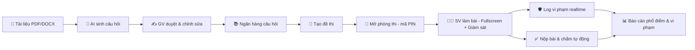

### 5.4. Giá trị mang lại
| Đối tượng | Giá trị |
|---|---|
| Giảng viên | Tiết kiệm thời gian, kết quả tin cậy hơn, có dữ liệu cải tiến bài giảng |
| Sinh viên | Thi công bằng, không mất bài, xem được kết quả chi tiết |
| Nhà trường | Minh bạch, có log làm căn cứ xử lý vi phạm |

---

## 6. TÁC NHÂN VÀ USE CASE

### 6.1. Tác nhân (Actors)

| Tác nhân | Mô tả | Cách xác thực |
|---|---|---|
| **Khách (Guest)** | Người chưa đăng nhập | — |
| **Sinh viên (Student)** | Tham gia phòng thi, làm bài, xem kết quả | Email + mật khẩu (JWT) |
| **Giảng viên (Teacher)** | Tạo câu hỏi, đề thi, phòng thi, giám sát, xem thống kê | Email + mật khẩu (JWT) |
| **Quản trị viên (Admin)** | Quản lý người dùng, cấu hình hệ thống | Email + mật khẩu (JWT) |
| **AI Service (hệ thống ngoài)** | Gemini API sinh câu hỏi | API Key (server-side) |
| **Scheduler (hệ thống)** | Tự động mở/đóng phòng, tự nộp bài khi hết giờ | Nội bộ |

### 6.2. Sơ đồ Use Case tổng quát

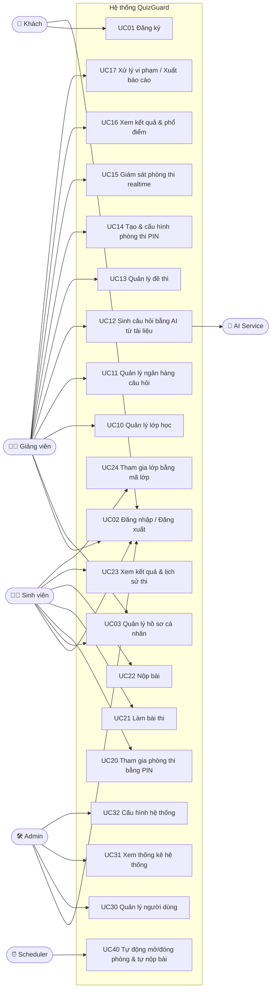

### 6.3. Đặc tả các Use Case quan trọng

#### UC12 – Sinh câu hỏi bằng AI từ tài liệu
| Mục | Nội dung |
|---|---|
| **Tác nhân** | Giảng viên, AI Service |
| **Tiền điều kiện** | GV đã đăng nhập |
| **Luồng chính** | 1. GV chọn "Tạo câu hỏi bằng AI".<br>2. GV upload file (PDF/DOCX/TXT, ≤ 10MB) hoặc dán văn bản.<br>3. GV cấu hình: số câu (5–50), độ khó (Dễ/TB/Khó/Trộn), loại câu (1 đáp án / nhiều đáp án), ngôn ngữ, chủ đề/tag.<br>4. Hệ thống trích xuất văn bản từ file.<br>5. Hệ thống gửi prompt + văn bản tới AI, yêu cầu trả về JSON theo schema.<br>6. Hệ thống validate JSON, hiển thị danh sách câu hỏi **ở trạng thái nháp**.<br>7. GV xem, sửa, xóa, sinh lại từng câu.<br>8. GV bấm "Lưu vào ngân hàng" → câu hỏi chuyển trạng thái `approved`. |
| **Luồng thay thế** | 4a. File scan (ảnh) không trích được chữ → báo lỗi "Không đọc được nội dung, vui lòng dùng file có text".<br>5a. Tài liệu quá dài → hệ thống chia đoạn (chunk) và gọi AI nhiều lần.<br>6a. AI trả JSON sai định dạng → tự động thử lại tối đa 2 lần, sau đó báo lỗi. |
| **Hậu điều kiện** | Câu hỏi được lưu vào ngân hàng câu hỏi của GV, gắn nguồn `source = AI` |

#### UC14 – Tạo & cấu hình phòng thi PIN
| Mục | Nội dung |
|---|---|
| **Tác nhân** | Giảng viên |
| **Tiền điều kiện** | Đã có ít nhất 1 đề thi |
| **Luồng chính** | 1. GV chọn đề thi → "Tạo phòng thi".<br>2. Cấu hình: tên phòng, thời lượng (phút), thời gian mở/đóng, lớp được phép (hoặc mở cho mọi người có PIN), số lần vi phạm tối đa, hành động khi vượt ngưỡng (cảnh báo / tự nộp bài / khóa bài), xáo trộn câu hỏi & đáp án, cho xem kết quả sau khi nộp hay không, yêu cầu fullscreen.<br>3. Hệ thống sinh **mã PIN 6 chữ số duy nhất** trong các phòng đang hoạt động.<br>4. Hiển thị PIN + QR code + link để GV chia sẻ. |
| **Hậu điều kiện** | Phòng ở trạng thái `scheduled` hoặc `open` |

#### UC21 – Làm bài thi (có giám sát)
| Mục | Nội dung |
|---|---|
| **Tác nhân** | Sinh viên |
| **Tiền điều kiện** | SV đã vào phòng hợp lệ (UC20), phòng đang `open` |
| **Luồng chính** | 1. Hệ thống hiển thị nội quy + yêu cầu bật fullscreen.<br>2. SV bấm "Bắt đầu" → server tạo `Attempt` với `startedAt` (giờ server), trả về `deadline`.<br>3. Client hiển thị câu hỏi (đã xáo trộn theo seed riêng), đồng hồ đếm ngược = `deadline - serverNow`.<br>4. Mỗi khi chọn đáp án → autosave lên server (debounce 500ms).<br>5. Client lắng nghe sự kiện: `visibilitychange`, `blur`, `fullscreenchange`, `copy`, `paste`, `contextmenu`, phím tắt (Ctrl+C/V/U, F12, PrintScreen).<br>6. Khi phát hiện vi phạm → gửi event tới server → server ghi `CheatLog`, tăng `violationCount`, đẩy realtime tới dashboard GV → client hiển thị cảnh báo.<br>7. Khi `violationCount ≥ maxViolations` → áp dụng hành động đã cấu hình. |
| **Luồng thay thế** | 4a. Mất mạng → lưu đáp án tạm vào `localStorage`, hiển thị "Đang offline", đồng bộ lại khi có mạng.<br>3a. SV F5 / đóng tab và vào lại → server trả lại attempt cũ + đáp án đã lưu + thời gian còn lại (không reset).<br>7a. Hết giờ → server tự nộp bài (Scheduler) dù client không gửi. |
| **Hậu điều kiện** | Attempt chuyển `submitted` / `auto_submitted` |

#### UC15 – Giám sát phòng thi realtime
| Mục | Nội dung |
|---|---|
| **Tác nhân** | Giảng viên |
| **Luồng chính** | 1. GV mở trang giám sát của phòng.<br>2. Client join Socket room `room:{roomId}:proctor`.<br>3. Bảng hiển thị từng SV: trạng thái (chưa vào / đang làm / đã nộp / mất kết nối), số câu đã làm, số vi phạm, vi phạm gần nhất.<br>4. Khi có vi phạm mới → dòng SV nhấp nháy đỏ + toast thông báo.<br>5. GV có thể: gửi cảnh báo riêng cho SV, cộng thêm thời gian, buộc nộp bài, đóng phòng sớm. |

---

## 7. YÊU CẦU CHỨC NĂNG CHI TIẾT

> Mức độ ưu tiên theo **MoSCoW**: **M** = Must have (MVP) · **S** = Should have · **C** = Could have · **W** = Won't have (lần này)

### 7.1. Module Xác thực & Tài khoản (AUTH)
| Mã | Chức năng | Mô tả | Ưu tiên |
|---|---|---|:---:|
| FR-AUTH-01 | Đăng ký | Họ tên, email, mật khẩu, vai trò (SV/GV — GV cần Admin duyệt) | M |
| FR-AUTH-02 | Đăng nhập | Email + mật khẩu, trả JWT access token (15p) + refresh token (7 ngày, httpOnly cookie) | M |
| FR-AUTH-03 | Đăng xuất | Thu hồi refresh token | M |
| FR-AUTH-04 | Phân quyền theo vai trò | Middleware RBAC: student / teacher / admin | M |
| FR-AUTH-05 | Quên mật khẩu | Gửi link reset qua email | S |
| FR-AUTH-06 | Cập nhật hồ sơ | Avatar, họ tên, MSSV, đổi mật khẩu | S |
| FR-AUTH-07 | Đăng nhập Google | OAuth 2.0 | C |

### 7.2. Module Lớp học (CLASS)
| Mã | Chức năng | Mô tả | Ưu tiên |
|---|---|---|:---:|
| FR-CLS-01 | Tạo/sửa/xóa lớp | Tên lớp, mã học phần, học kỳ | S |
| FR-CLS-02 | Mã tham gia lớp | Sinh mã 8 ký tự, SV nhập để vào lớp | S |
| FR-CLS-03 | Import danh sách SV | Upload CSV (MSSV, họ tên, email) | C |
| FR-CLS-04 | Xem danh sách thành viên | Có thể xóa SV khỏi lớp | S |

### 7.3. Module Ngân hàng câu hỏi (QBANK)
| Mã | Chức năng | Mô tả | Ưu tiên |
|---|---|---|:---:|
| FR-QB-01 | CRUD câu hỏi thủ công | Nội dung, 2–6 phương án, đáp án đúng, giải thích, độ khó, tag | M |
| FR-QB-02 | Loại câu hỏi | Một đáp án (single) / Nhiều đáp án (multiple) | M |
| FR-QB-03 | Tìm kiếm & lọc | Theo từ khóa, tag, độ khó, nguồn (AI/thủ công) | M |
| FR-QB-04 | Phân trang danh sách | Server-side pagination | M |
| FR-QB-05 | Import từ Excel/CSV | Theo template mẫu | C |
| FR-QB-06 | Hỗ trợ ảnh & công thức | Upload ảnh vào câu hỏi, hiển thị LaTeX (KaTeX) | C |

### 7.4. Module Sinh câu hỏi AI (AIGEN)
| Mã | Chức năng | Mô tả | Ưu tiên |
|---|---|---|:---:|
| FR-AI-01 | Upload tài liệu | PDF, DOCX, TXT ≤ 10MB; hoặc dán văn bản | M |
| FR-AI-02 | Trích xuất văn bản | `pdf-parse` (PDF), `mammoth` (DOCX) | M |
| FR-AI-03 | Cấu hình sinh đề | Số câu, độ khó, loại câu, ngôn ngữ | M |
| FR-AI-04 | Gọi AI & validate | Prompt yêu cầu JSON schema; validate bằng Zod/Joi; retry ≤ 2 lần | M |
| FR-AI-05 | Duyệt câu hỏi nháp | Xem, sửa, xóa, chọn lưu từng câu hoặc tất cả | M |
| FR-AI-06 | Sinh lại 1 câu | Yêu cầu AI tạo lại một câu cụ thể | S |
| FR-AI-07 | Chia nhỏ tài liệu dài | Chunk theo đoạn ~3.000 từ, phân bổ số câu theo chunk | S |
| FR-AI-08 | Lịch sử phiên sinh đề | Lưu file nguồn, cấu hình, số câu sinh ra | C |
| FR-AI-09 | Giới hạn sử dụng | Mỗi GV tối đa N lượt/ngày (tránh tốn chi phí API) | S |

### 7.5. Module Đề thi (EXAM)
| Mã | Chức năng | Mô tả | Ưu tiên |
|---|---|---|:---:|
| FR-EX-01 | Tạo đề thủ công | Chọn câu hỏi từ ngân hàng, sắp xếp thứ tự, điểm từng câu | M |
| FR-EX-02 | Tạo đề ngẫu nhiên | Bốc ngẫu nhiên theo ma trận: tag × độ khó × số câu | S |
| FR-EX-03 | Sửa/xóa/nhân bản đề | Không cho sửa nếu đề đang được dùng trong phòng `open` | M |
| FR-EX-04 | Xem trước đề | Giao diện giống SV nhìn thấy | S |
| FR-EX-05 | Xuất đề ra PDF/Word | In đề thi giấy | C |

### 7.6. Module Phòng thi (ROOM)
| Mã | Chức năng | Mô tả | Ưu tiên |
|---|---|---|:---:|
| FR-RM-01 | Tạo phòng thi | Từ 1 đề thi, sinh PIN 6 số duy nhất | M |
| FR-RM-02 | Cấu hình thời gian | Thời lượng làm bài; thời gian mở – đóng phòng | M |
| FR-RM-03 | Cấu hình giám sát | Bắt buộc fullscreen; ngưỡng vi phạm; hành động khi vượt ngưỡng | M |
| FR-RM-04 | Xáo trộn | Xáo câu hỏi và đáp án theo seed riêng từng SV | M |
| FR-RM-05 | Giới hạn đối tượng | Chỉ SV thuộc lớp X / bất kỳ ai có PIN + đăng nhập | S |
| FR-RM-06 | Chia sẻ phòng | Hiển thị PIN cỡ lớn (chiếu lên máy chiếu), QR code, link | S |
| FR-RM-07 | Điều khiển phòng | Mở ngay, đóng sớm, gia hạn thời gian | M |
| FR-RM-08 | Cấu hình xem kết quả | Không xem / Xem điểm / Xem điểm + đáp án sau khi phòng đóng | S |

### 7.7. Module Làm bài thi (TAKE)
| Mã | Chức năng | Mô tả | Ưu tiên |
|---|---|---|:---:|
| FR-TK-01 | Vào phòng bằng PIN | Nhập PIN → kiểm tra trạng thái phòng & quyền | M |
| FR-TK-02 | Phòng chờ & nội quy | Hiển thị thông tin đề, nội quy, nút bật fullscreen | M |
| FR-TK-03 | Đồng hồ đồng bộ server | Tính theo `deadline` server và độ lệch đồng hồ (`serverOffset`) | M |
| FR-TK-04 | Giao diện làm bài | Hiển thị từng câu / tất cả câu, bảng điều hướng số câu, đánh dấu "xem lại" | M |
| FR-TK-05 | Autosave | Lưu đáp án lên server khi chọn (debounce), có trạng thái "Đã lưu" | M |
| FR-TK-06 | Khôi phục bài làm | F5 / vào lại → khôi phục đáp án & thời gian còn lại | M |
| FR-TK-07 | Hỗ trợ offline tạm thời | Queue đáp án trong localStorage, sync khi online | S |
| FR-TK-08 | Nộp bài | Xác nhận, cảnh báo câu chưa làm | M |
| FR-TK-09 | Tự động nộp khi hết giờ | Cả client và server (server là nguồn tin cậy) | M |

### 7.8. Module Chống gian lận (PROCTOR)
| Mã | Chức năng | Mô tả | Ưu tiên |
|---|---|---|:---:|
| FR-PR-01 | Phát hiện chuyển tab | `document.visibilitychange` → `hidden` | M |
| FR-PR-02 | Phát hiện mất focus | `window.blur` (mở app khác, click ra ngoài) | M |
| FR-PR-03 | Phát hiện thoát fullscreen | `fullscreenchange` khi `document.fullscreenElement == null` | M |
| FR-PR-04 | Chặn copy/paste/chuột phải | `copy`, `cut`, `paste`, `contextmenu` → `preventDefault` + log | M |
| FR-PR-05 | Chặn phím tắt | Ctrl+C/V/X/U/P/S, F12, Ctrl+Shift+I, PrintScreen | S |
| FR-PR-06 | Ghi log vi phạm | Loại, thời điểm, thời lượng rời trang, câu đang làm | M |
| FR-PR-07 | Cảnh báo SV | Modal cảnh báo + đếm "Bạn đã vi phạm 2/3 lần" | M |
| FR-PR-08 | Xử lý vượt ngưỡng | Chỉ ghi nhận / Tự nộp bài / Khóa bài chờ GV mở | M |
| FR-PR-09 | Heartbeat | Client ping 15s/lần; mất > 30s → trạng thái "Mất kết nối" | S |
| FR-PR-10 | Phát hiện nhiều phiên | Cùng tài khoản mở 2 tab/thiết bị → chỉ phiên mới nhất hợp lệ, log vi phạm | S |
| FR-PR-11 | Phát hiện DevTools | Heuristic kích thước cửa sổ | C |

### 7.9. Module Giám sát realtime (MONITOR)
| Mã | Chức năng | Mô tả | Ưu tiên |
|---|---|---|:---:|
| FR-MN-01 | Bảng trạng thái thí sinh | Realtime qua Socket.IO | M |
| FR-MN-02 | Thông báo vi phạm tức thì | Toast + highlight dòng | M |
| FR-MN-03 | Timeline vi phạm của 1 SV | Xem chi tiết log | S |
| FR-MN-04 | Hành động với SV | Gửi cảnh báo, cộng giờ, buộc nộp, mở khóa bài | S |
| FR-MN-05 | Thống kê nhanh | Đã vào / đang làm / đã nộp / số vi phạm | M |

### 7.10. Module Kết quả & Thống kê (REPORT)
| Mã | Chức năng | Mô tả | Ưu tiên |
|---|---|---|:---:|
| FR-RP-01 | Chấm điểm tự động | Single: đúng/sai; Multiple: đúng hoàn toàn hoặc chấm từng phần (cấu hình) | M |
| FR-RP-02 | Bảng điểm phòng thi | MSSV, họ tên, điểm, thời gian làm, số vi phạm, trạng thái | M |
| FR-RP-03 | Phổ điểm | Histogram theo khoảng điểm (0–1, 1–2, …, 9–10) | M |
| FR-RP-04 | Chỉ số thống kê | Trung bình, trung vị, độ lệch chuẩn, max, min, tỉ lệ đạt | M |
| FR-RP-05 | Phân tích câu hỏi | Tỉ lệ đúng từng câu, phân bố chọn từng phương án, chỉ số độ khó p | S |
| FR-RP-06 | Xuất Excel/CSV | Bảng điểm + vi phạm | S |
| FR-RP-07 | SV xem kết quả | Điểm, đáp án đúng/sai, giải thích (tùy cấu hình) | M |
| FR-RP-08 | Lịch sử thi của SV | Danh sách các bài đã thi | S |
| FR-RP-09 | Chỉ số phân biệt (D-index) | So sánh nhóm 27% cao/thấp | C |

### 7.11. Module Quản trị (ADMIN)
| Mã | Chức năng | Mô tả | Ưu tiên |
|---|---|---|:---:|
| FR-AD-01 | Quản lý người dùng | Danh sách, tìm kiếm, khóa/mở khóa, đổi vai trò | M |
| FR-AD-02 | Duyệt tài khoản giảng viên | Phê duyệt yêu cầu đăng ký vai trò GV | M |
| FR-AD-03 | Dashboard hệ thống | Số người dùng, số phòng thi, lượt gọi AI | S |
| FR-AD-04 | Cấu hình hệ thống | Hạn mức AI/ngày, dung lượng upload tối đa | C |

---

## 8. YÊU CẦU PHI CHỨC NĂNG

| Mã | Nhóm | Yêu cầu |
|---|---|---|
| NFR-01 | Hiệu năng | API CRUD phản hồi < 300ms (p95); autosave < 500ms; sự kiện vi phạm hiển thị trên dashboard GV < 2 giây |
| NFR-02 | Tải đồng thời | Hỗ trợ ≥ 200 thí sinh đồng thời trong 1 phòng (quy mô lớp học HUST) |
| NFR-03 | Thời gian sinh đề AI | 20 câu từ tài liệu ~10 trang < 60 giây, có thanh tiến trình |
| NFR-04 | Bảo mật – Xác thực | Mật khẩu hash bcrypt (cost 10); JWT ký HS256; refresh token httpOnly + SameSite |
| NFR-05 | Bảo mật – Dữ liệu đề thi | **Không bao giờ gửi đáp án đúng xuống client** khi đang thi; chấm điểm ở server |
| NFR-06 | Bảo mật – Web | Chống XSS (sanitize nội dung câu hỏi), chống SQL/NoSQL injection, Helmet, CORS whitelist, rate limit (đăng nhập, nhập PIN: 5 lần/phút) |
| NFR-07 | Tin cậy | Không mất đáp án đã autosave; server là nguồn thời gian duy nhất |
| NFR-08 | Khả dụng | Giao diện tiếng Việt; responsive (làm bài tốt trên laptop, xem kết quả được trên mobile) |
| NFR-09 | Tương thích | Chrome, Edge, Firefox bản mới; cảnh báo nếu trình duyệt không hỗ trợ Fullscreen API |
| NFR-10 | Khả năng bảo trì | Code chia module, ESLint + Prettier, README hướng dẫn chạy, biến môi trường `.env` |
| NFR-11 | Triển khai | Frontend deploy Vercel/Netlify; Backend Render/Railway; DB MongoDB Atlas / PostgreSQL cloud |
| NFR-12 | Quyền riêng tư | Không thu thập webcam/micro; log chỉ chứa sự kiện trình duyệt; thông báo rõ cho SV trước khi thi |

---

## 9. QUY TẮC NGHIỆP VỤ

| Mã | Quy tắc |
|---|---|
| BR-01 | Mã PIN gồm **6 chữ số**, duy nhất trong số các phòng có trạng thái `scheduled` hoặc `open`. Phòng đóng thì PIN được giải phóng. |
| BR-02 | Mỗi sinh viên chỉ có **1 attempt** trong một phòng thi (trừ khi GV cho phép thi lại). |
| BR-03 | `deadline = min(startedAt + duration, room.closeAt)`. Thời gian luôn tính theo **giờ server**. |
| BR-04 | Server **từ chối** mọi request lưu đáp án sau `deadline + 5 giây` (grace period cho độ trễ mạng). |
| BR-05 | Khi hết `deadline`, attempt chưa nộp sẽ được Scheduler chuyển `auto_submitted` và chấm điểm với các đáp án đã lưu. |
| BR-06 | Một lần rời trang (tab ẩn → hiện lại) chỉ tính **1 vi phạm** dù phát sinh cả `blur` lẫn `visibilitychange` (gộp sự kiện trong cửa sổ 1 giây). |
| BR-07 | Rời trang **> 10 giây** liên tục được đánh dấu mức độ **nghiêm trọng (high)**. |
| BR-08 | Khi `violationCount ≥ maxViolations`: thực hiện `onExceed` ∈ {`log_only`, `auto_submit`, `lock`}. Bài bị `lock` chỉ GV mới mở được. |
| BR-09 | Thang điểm hiển thị quy về **10**. Điểm câu `multiple`: mặc định đúng hoàn toàn mới được điểm (có tùy chọn chấm từng phần). |
| BR-10 | Không được sửa nội dung đề thi khi đã có phòng thi `open` sử dụng đề đó (tránh lệch dữ liệu chấm). Khi tạo phòng, hệ thống **snapshot** đề thi. |
| BR-11 | Câu hỏi do AI sinh ra luôn ở trạng thái `draft` cho tới khi GV duyệt. Không thể đưa câu `draft` vào đề thi. |
| BR-12 | Tài khoản giảng viên đăng ký mới ở trạng thái `pending` cho tới khi Admin duyệt. |
| BR-13 | Nhập sai PIN quá 5 lần/phút → tạm khóa nhập PIN 1 phút (chống dò PIN). |

---

## 10. ĐỊNH NGHĨA MVP

### 10.1. Tuyên bố MVP
> **MVP của QuizGuard** phải chứng minh được **một vòng đời hoàn chỉnh**: *Giảng viên upload tài liệu → AI sinh câu hỏi → duyệt → tạo đề → mở phòng PIN → sinh viên vào thi trong chế độ fullscreen có giám sát → giảng viên thấy vi phạm realtime → nộp bài/tự nộp → xem điểm và phổ điểm.*

### 10.2. Tiêu chí thành công của MVP
| # | Tiêu chí | Cách đo |
|---|---|---|
| 1 | Sinh được ≥ 10 câu hỏi hợp lệ từ 1 file PDF bài giảng | Demo với slide môn học |
| 2 | 30+ người thi cùng lúc trong 1 phòng không lỗi | Test với cả lớp |
| 3 | 100% lần chuyển tab / thoát fullscreen được ghi log và hiện trên dashboard GV < 2s | Test thủ công |
| 4 | F5 trang thi không mất đáp án, không reset đồng hồ | Test thủ công |
| 5 | Có bảng điểm + biểu đồ phổ điểm ngay sau khi đóng phòng | Demo |

### 10.3. Phạm vi MVP theo MoSCoW

| Nhóm | Bao gồm |
|---|---|
| ✅ **MUST (MVP – bắt buộc)** | Đăng ký/đăng nhập/JWT/RBAC · CRUD ngân hàng câu hỏi (single & multiple) · Upload PDF/DOCX + AI sinh câu hỏi + duyệt · Tạo đề thủ công · Tạo phòng PIN + cấu hình thời gian/giám sát/xáo trộn · Vào phòng bằng PIN · Làm bài fullscreen + đồng hồ server + autosave + khôi phục · Phát hiện chuyển tab/blur/thoát fullscreen/copy-paste + log + cảnh báo + xử lý vượt ngưỡng · Dashboard giám sát realtime · Tự nộp khi hết giờ · Chấm tự động · Bảng điểm + phổ điểm + thống kê cơ bản · SV xem kết quả · Admin quản lý & duyệt user |
| 🟡 **SHOULD (Nếu kịp)** | Lớp học + mã tham gia lớp · Tạo đề ngẫu nhiên theo ma trận · Sinh lại 1 câu · Chunk tài liệu dài · Phân tích từng câu hỏi · Xuất Excel · QR code phòng · Heartbeat & đa phiên · Hành động GV với SV (cộng giờ, buộc nộp) · Offline queue · Hạn mức AI |
| 🔵 **COULD (Mở rộng)** | Import CSV câu hỏi/SV · Ảnh & LaTeX trong câu hỏi · Đăng nhập Google · Xuất đề PDF · D-index · Phát hiện DevTools · Dark mode |
| ⛔ **WON'T (Không làm lần này)** | Webcam/nhận diện khuôn mặt · App mobile · Tự luận chấm AI · Tích hợp LMS trường · Thanh toán |

### 10.4. Lộ trình phát hành (Release Plan)

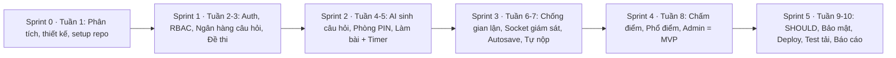

> [!IMPORTANT]
> Nếu thiếu thời gian, **tuyệt đối giữ** 3 tính năng tạo nên bản sắc đề tài: **AI sinh câu hỏi**, **phòng PIN + giám sát chuyển tab/fullscreen realtime**, **đồng hồ server + phổ điểm**. Các tính năng khác có thể cắt.

---

## 11. SƠ ĐỒ PHÂN RÃ CHỨC NĂNG (BFD)

### 11.1. BFD tổng quát (cấp 1)

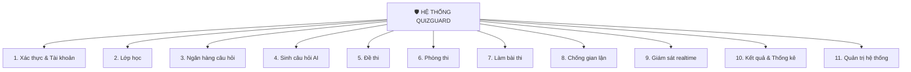

### 11.2. BFD chi tiết (cấp 2 – cấp 3)

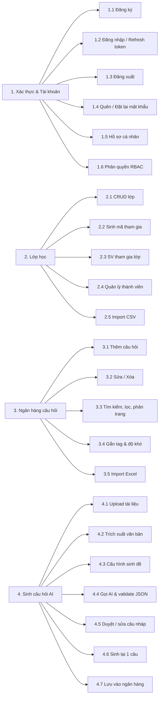

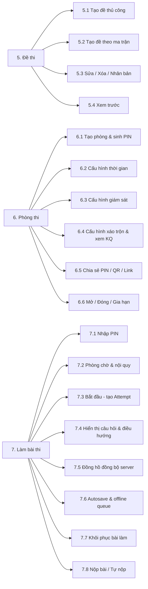

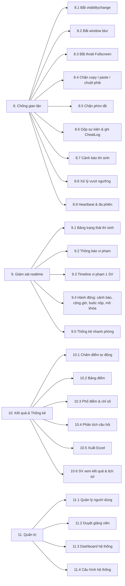

### 11.3. Ma trận phân quyền (Role × Chức năng)

| Chức năng | Guest | Student | Teacher | Admin |
|---|:---:|:---:|:---:|:---:|
| Đăng ký / Đăng nhập | ✅ | ✅ | ✅ | ✅ |
| Cập nhật hồ sơ | — | ✅ | ✅ | ✅ |
| Tham gia lớp bằng mã | — | ✅ | — | — |
| CRUD lớp học | — | — | ✅ (lớp của mình) | ✅ |
| CRUD câu hỏi | — | — | ✅ (của mình) | ✅ |
| Sinh câu hỏi AI | — | — | ✅ | ✅ |
| CRUD đề thi | — | — | ✅ (của mình) | ✅ |
| Tạo / điều khiển phòng thi | — | — | ✅ (của mình) | ✅ |
| Nhập PIN & làm bài | — | ✅ | ❌ (chỉ xem trước) | — |
| Giám sát phòng thi | — | — | ✅ (phòng của mình) | ✅ |
| Xem bảng điểm & phổ điểm | — | — | ✅ | ✅ |
| Xem kết quả cá nhân | — | ✅ (bài của mình) | — | — |
| Quản lý người dùng / duyệt GV | — | — | — | ✅ |

---

## 12. SƠ ĐỒ MÀN HÌNH (SITEMAP & SCREEN FLOW)

### 12.1. Danh mục màn hình

| Mã | Tên màn hình | Route | Vai trò |
|---|---|---|---|
| **Chung** ||||
| S01 | Landing page | `/` | Tất cả |
| S02 | Đăng nhập | `/login` | Guest |
| S03 | Đăng ký | `/register` | Guest |
| S04 | Quên mật khẩu / Đặt lại | `/forgot-password`, `/reset-password/:token` | Guest |
| S05 | Hồ sơ cá nhân | `/profile` | Đã đăng nhập |
| S06 | Trang lỗi 403 / 404 | `/403`, `*` | Tất cả |
| **Giảng viên** ||||
| T01 | Dashboard giảng viên | `/teacher` | Teacher |
| T02 | Danh sách lớp | `/teacher/classes` | Teacher |
| T03 | Chi tiết lớp | `/teacher/classes/:id` | Teacher |
| T04 | Ngân hàng câu hỏi | `/teacher/questions` | Teacher |
| T05 | Form thêm/sửa câu hỏi (modal) | `/teacher/questions/new`, `/:id/edit` | Teacher |
| T06 | Sinh câu hỏi AI – Bước 1: Upload & cấu hình | `/teacher/ai-generate` | Teacher |
| T07 | Sinh câu hỏi AI – Bước 2: Đang xử lý | `/teacher/ai-generate/:jobId` | Teacher |
| T08 | Sinh câu hỏi AI – Bước 3: Duyệt câu hỏi | `/teacher/ai-generate/:jobId/review` | Teacher |
| T09 | Danh sách đề thi | `/teacher/exams` | Teacher |
| T10 | Trình tạo/sửa đề thi | `/teacher/exams/new`, `/:id/edit` | Teacher |
| T11 | Xem trước đề thi | `/teacher/exams/:id/preview` | Teacher |
| T12 | Danh sách phòng thi | `/teacher/rooms` | Teacher |
| T13 | Tạo/cấu hình phòng thi | `/teacher/rooms/new` | Teacher |
| T14 | Màn hình chiếu mã PIN | `/teacher/rooms/:id/present` | Teacher |
| T15 | **Dashboard giám sát realtime** | `/teacher/rooms/:id/monitor` | Teacher |
| T16 | Chi tiết vi phạm 1 thí sinh (drawer) | `/teacher/rooms/:id/monitor?student=:sid` | Teacher |
| T17 | **Kết quả & phổ điểm phòng thi** | `/teacher/rooms/:id/results` | Teacher |
| T18 | Xem bài làm chi tiết 1 SV | `/teacher/attempts/:id` | Teacher |
| **Sinh viên** ||||
| U01 | Dashboard sinh viên | `/student` | Student |
| U02 | Nhập mã PIN | `/join` | Student |
| U03 | Phòng chờ & nội quy | `/exam/:roomId/lobby` | Student |
| U04 | **Màn hình làm bài** | `/exam/:roomId/attempt` | Student |
| U05 | Modal cảnh báo vi phạm | (overlay trên U04) | Student |
| U06 | Modal xác nhận nộp bài | (overlay trên U04) | Student |
| U07 | Màn hình nộp bài thành công | `/exam/:roomId/submitted` | Student |
| U08 | Kết quả bài thi | `/student/attempts/:id` | Student |
| U09 | Lịch sử thi | `/student/history` | Student |
| U10 | Lớp học của tôi | `/student/classes` | Student |
| **Admin** ||||
| A01 | Dashboard Admin | `/admin` | Admin |
| A02 | Quản lý người dùng | `/admin/users` | Admin |
| A03 | Duyệt giảng viên | `/admin/teacher-requests` | Admin |
| A04 | Cấu hình hệ thống | `/admin/settings` | Admin |

> **Tổng cộng: 6 màn hình chung + 18 màn hình Giảng viên + 10 màn hình Sinh viên + 4 màn hình Admin = 38 màn hình/trạng thái.**

### 12.2. Sitemap tổng thể

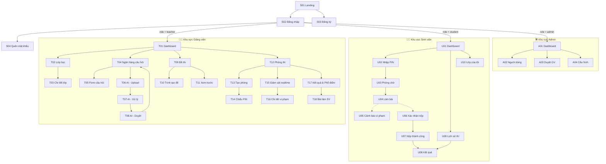

### 12.3. Screen Flow – Luồng Giảng viên tạo đề bằng AI và mở phòng thi

```mermaid
flowchart LR
    A["T01 Dashboard"] -->|"Bấm Tạo câu hỏi AI"| B["T06 Upload file + cấu hình"]
    B -->|"Bấm Sinh câu hỏi"| C["T07 Thanh tiến trình"]
    C -->|"Thành công"| D["T08 Duyệt danh sách nháp"]
    C -->|"Lỗi"| B
    D -->|"Sửa / Xóa / Sinh lại"| D
    D -->|"Lưu đã chọn"| E["T04 Ngân hàng câu hỏi"]
    E -->|"Tạo đề"| F["T10 Chọn câu hỏi, sắp xếp, đặt điểm"]
    F -->|"Lưu đề"| G["T09 Danh sách đề"]
    G -->|"Tạo phòng thi"| H["T13 Cấu hình phòng"]
    H -->|"Tạo"| I["T14 Chiếu PIN + QR"]
    I -->|"Mở giám sát"| J["T15 Dashboard giám sát"]
    J -->|"Đóng phòng"| K["T17 Kết quả & phổ điểm"]
```

### 12.4. Screen Flow – Luồng Sinh viên làm bài

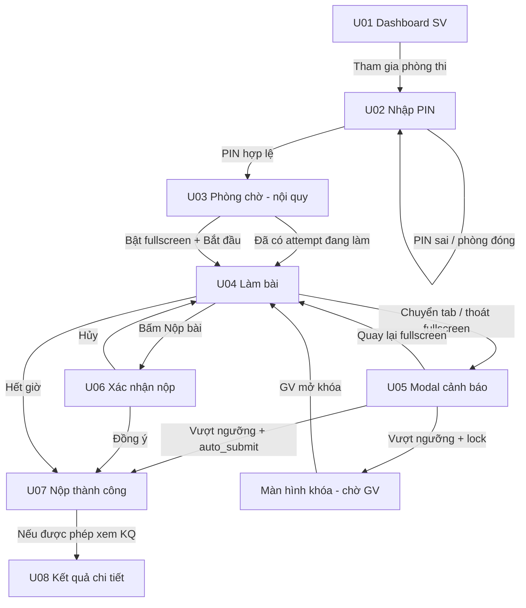

---

## 13. ĐẶC TẢ MÀN HÌNH & WIREFRAME

> Quy ước wireframe: `[ Nút ]`, `( ) Radio`, `[x] Checkbox`, `[____] Input`, `[▼] Dropdown`, `▓` vùng nổi bật.

### 13.1. S02 – Đăng nhập

```text
┌──────────────────────────────────────────────────────────┐
│                     🛡️ QuizGuard                          │
│          Thi trắc nghiệm trực tuyến có giám sát           │
│                                                          │
│   Email      [_________________________________]          │
│   Mật khẩu   [_________________________] [👁]            │
│                                                          │
│   [x] Ghi nhớ đăng nhập          Quên mật khẩu?           │
│                                                          │
│   [            ĐĂNG NHẬP            ]                     │
│                                                          │
│   Chưa có tài khoản?  Đăng ký                             │
└──────────────────────────────────────────────────────────┘
```

| Thành phần | Kiểu | Validate / Hành vi |
|---|---|---|
| Email | input email | Bắt buộc, đúng định dạng |
| Mật khẩu | input password | Bắt buộc, ≥ 8 ký tự |
| Đăng nhập | button | `POST /api/auth/login` → lưu access token (memory) → điều hướng theo role |
| Lỗi | alert | "Email hoặc mật khẩu không đúng" / "Tài khoản đang chờ duyệt" / "Tài khoản bị khóa" |

### 13.2. T01 – Dashboard Giảng viên

```text
┌────────────┬─────────────────────────────────────────────────────────────┐
│ 🛡️QuizGuard│  Xin chào, TS. Nguyễn Văn Hùng                 🔔  👤 ▼      │
├────────────┼─────────────────────────────────────────────────────────────┤
│ 🏠 Tổng quan│  ┌──────────┐ ┌──────────┐ ┌──────────┐ ┌──────────┐        │
│ 👥 Lớp học  │  │ 📚 245   │ │ 📝 12    │ │ 🔴 1     │ │ 👩‍🎓 356  │        │
│ ❓ Câu hỏi  │  │ Câu hỏi  │ │ Đề thi   │ │ Đang thi │ │ Lượt thi │        │
│ 🤖 Tạo bằng AI│ └──────────┘ └──────────┘ └──────────┘ └──────────┘        │
│ 📝 Đề thi   │                                                             │
│ 🚪 Phòng thi│  ⚡ Thao tác nhanh                                           │
│ 📊 Báo cáo  │  [🤖 Tạo câu hỏi từ tài liệu] [📝 Tạo đề] [🚪 Mở phòng thi]    │
│            │                                                             │
│            │  🔴 Phòng đang diễn ra                                       │
│            │  ┌───────────────────────────────────────────────────────┐  │
│            │  │ Quiz Chương 5 – IT4409   PIN 482 913   45/52 đang làm │  │
│            │  │ ⚠ 7 vi phạm   ⏱ còn 08:21          [Giám sát →]        │  │
│            │  └───────────────────────────────────────────────────────┘  │
│            │                                                             │
│            │  📅 Phòng sắp tới            │ 📈 Điểm TB 5 phòng gần nhất   │
│            │  • Giữa kỳ IT3080 – 14/11    │   ▁▃▅▆▄                      │
│            │  • Quiz Ch.6 – 18/11         │                              │
└────────────┴─────────────────────────────────────────────────────────────┘
```

### 13.3. T04 – Ngân hàng câu hỏi

```text
┌───────────────────────────────────────────────────────────────────────────┐
│ ❓ Ngân hàng câu hỏi                      [🤖 Tạo bằng AI] [+ Thêm câu hỏi] │
├───────────────────────────────────────────────────────────────────────────┤
│ 🔍 [Tìm theo nội dung...........]  Tag [▼ Tất cả]  Độ khó [▼]  Nguồn [▼ AI/Thủ công] │
├───┬───────────────────────────────────────────┬──────┬───────┬──────┬─────┤
│[ ]│ Nội dung                                  │ Loại │Độ khó │ Tag  │ ⋯   │
├───┼───────────────────────────────────────────┼──────┼───────┼──────┼─────┤
│[ ]│ HTTP method nào là idempotent?            │Single│ TB    │ HTTP │✏️ 🗑│
│[ ]│ Fetch API trả về đối tượng gì?    🤖AI    │Single│ Dễ    │ JS   │✏️ 🗑│
│[ ]│ Chọn các status code thuộc nhóm 4xx 🤖AI  │Multi │ Khó   │ HTTP │✏️ 🗑│
├───┴───────────────────────────────────────────┴──────┴───────┴──────┴─────┤
│ Đã chọn 0   [Thêm vào đề ▼]  [Xóa]          « 1 2 3 … 25 »   10/trang [▼] │
└───────────────────────────────────────────────────────────────────────────┘
```

**T05 – Modal Thêm/Sửa câu hỏi**
```text
┌──────────────── Thêm câu hỏi ─────────────────┐
│ Loại:  (•) Một đáp án   ( ) Nhiều đáp án        │
│ Nội dung câu hỏi                                │
│ [_____________________________________________] │
│ Phương án (chọn đáp án đúng):                   │
│  (•) A [GET_______________________]  🗑         │
│  ( ) B [POST______________________]  🗑         │
│  ( ) C [PATCH_____________________]  🗑         │
│  ( ) D [CONNECT___________________]  🗑         │
│  [+ Thêm phương án]  (2–6 phương án)            │
│ Giải thích  [_________________________________] │
│ Độ khó [▼ Trung bình]   Tag [HTTP ✕][REST ✕][+] │
│                         [Hủy]  [💾 Lưu câu hỏi] │
└─────────────────────────────────────────────────┘
```

### 13.4. T06 → T07 → T08 – Sinh câu hỏi bằng AI (Wizard 3 bước)

**T06 – Bước 1: Upload & cấu hình**
```text
┌───────────────────────────────────────────────────────────────────┐
│ 🤖 Tạo câu hỏi bằng AI      ① Tài liệu ─── ② Xử lý ─── ③ Duyệt     │
├───────────────────────────────────────────────────────────────────┤
│  ┌─────────────────────────────────────────────────────────────┐  │
│  │          📄 Kéo thả file vào đây hoặc [Chọn file]             │  │
│  │            Hỗ trợ: PDF, DOCX, TXT · Tối đa 10MB              │  │
│  └─────────────────────────────────────────────────────────────┘  │
│   ✅ lec_7-web_api.pdf (3.1MB · 58 trang)              [✕]         │
│   hoặc  [ Dán văn bản trực tiếp ]                                 │
│                                                                   │
│  Số câu hỏi      [ 20 ] (5–50)                                    │
│  Độ khó          ( ) Dễ ( ) TB ( ) Khó (•) Trộn                    │
│  Loại câu        [x] Một đáp án  [x] Nhiều đáp án                  │
│  Ngôn ngữ        [▼ Tiếng Việt]                                   │
│  Tag gắn kèm     [Web API ✕][+]                                   │
│  Ghi chú cho AI  [Tập trung vào Fetch, REST, status code....]     │
│                                                                   │
│  Lượt còn lại hôm nay: 8/10              [ ✨ Sinh câu hỏi → ]      │
└───────────────────────────────────────────────────────────────────┘
```

**T07 – Bước 2: Đang xử lý**
```text
┌───────────────────────────────────────────────────────┐
│   ✅ Tải file lên                                      │
│   ✅ Trích xuất văn bản (12.430 từ)                    │
│   ⏳ AI đang sinh câu hỏi… (đoạn 2/4)                   │
│   ▓▓▓▓▓▓▓▓▓▓▓▓░░░░░░░░░  55%                            │
│   ○ Kiểm tra định dạng                                 │
│                                   [Hủy]                │
└───────────────────────────────────────────────────────┘
```

**T08 – Bước 3: Duyệt câu hỏi nháp**
```text
┌──────────────────────────────────────────────────────────────────────┐
│ ③ Duyệt câu hỏi (20 câu nháp)   [x] Chọn tất cả    [💾 Lưu 18 câu đã chọn] │
├──────────────────────────────────────────────────────────────────────┤
│ [x] Câu 1 · Single · TB                         [✏️ Sửa][🔄 Sinh lại][🗑]│
│     Phương thức HTTP nào thường dùng để cập nhật toàn bộ tài nguyên?   │
│       A. GET   ✅B. PUT   C. DELETE   D. OPTIONS                      │
│     💡 Giải thích: PUT thay thế toàn bộ tài nguyên tại URI…           │
│     📎 Nguồn: trang 14                                                │
├──────────────────────────────────────────────────────────────────────┤
│ [ ] Câu 2 · Multi · Khó   ⚠ Phương án trùng lặp                        │
│     …                                                                 │
└──────────────────────────────────────────────────────────────────────┘
```

| Thành phần | Hành vi |
|---|---|
| Cảnh báo chất lượng | Hệ thống tự kiểm tra: phương án trùng nhau, không có đáp án đúng, câu quá ngắn → gắn nhãn ⚠ |
| Sửa | Mở T05 với dữ liệu điền sẵn |
| Sinh lại | Gọi `POST /api/ai/jobs/:id/questions/:qid/regenerate` |
| Lưu | Câu được chọn → `approved`, chuyển về T04 |

### 13.5. T10 – Trình tạo đề thi

```text
┌──────────────────────────────────────────────────────────────────────────┐
│ 📝 Tạo đề thi   Tên [Quiz Chương 5 – Web API______]  Mô tả [__________]   │
├───────────────────────────────────┬──────────────────────────────────────┤
│ NGÂN HÀNG CÂU HỎI                  │ ĐỀ THI (15 câu · tổng 10 điểm)        │
│ 🔍[______] Tag[▼] Độ khó[▼]        │ ⇅ Kéo thả để sắp xếp                  │
│ ┌───────────────────────────────┐ │ ┌──────────────────────────────────┐ │
│ │ HTTP method idempotent?   [+] │ │ │ 1. Fetch trả về…    điểm[0.5] [✕]│ │
│ │ Status 201 nghĩa là?      [+] │→│ │ 2. PUT vs PATCH…    điểm[0.5] [✕]│ │
│ │ CORS là gì?               [+] │ │ │ 3. …                             │ │
│ └───────────────────────────────┘ │ └──────────────────────────────────┘ │
│ [🎲 Bốc ngẫu nhiên theo ma trận]   │ Phân bố: Dễ 5 · TB 7 · Khó 3          │
│                                   │ [Chia đều điểm] [👁 Xem trước] [💾 Lưu]│
└───────────────────────────────────┴──────────────────────────────────────┘
```

### 13.6. T13 – Tạo & cấu hình phòng thi

```text
┌─────────────────────────── Tạo phòng thi ─────────────────────────────┐
│ ① THÔNG TIN CHUNG                                                     │
│   Tên phòng   [Quiz Chương 5 – Nhóm 152___________]                    │
│   Đề thi      [▼ Quiz Chương 5 – Web API (15 câu)]                     │
│   Đối tượng   (•) Lớp [▼ IT4409-152]   ( ) Bất kỳ ai có PIN            │
│                                                                       │
│ ② THỜI GIAN                                                           │
│   Thời lượng làm bài [ 15 ] phút                                      │
│   Mở phòng   (•) Ngay   ( ) Hẹn giờ [09/11/2026 08:00]                 │
│   Đóng phòng [09/11/2026 08:30]                                       │
│                                                                       │
│ ③ GIÁM SÁT CHỐNG GIAN LẬN                                             │
│   [x] Bắt buộc toàn màn hình (Fullscreen)                              │
│   [x] Phát hiện chuyển tab / rời cửa sổ                                │
│   [x] Chặn copy, paste, chuột phải                                     │
│   [x] Chặn phím tắt (F12, Ctrl+U, PrintScreen…)                        │
│   Số vi phạm tối đa   [ 3 ]                                            │
│   Khi vượt ngưỡng     (•) Tự động nộp bài ( ) Khóa bài ( ) Chỉ ghi nhận │
│                                                                       │
│ ④ HIỂN THỊ                                                            │
│   [x] Xáo trộn thứ tự câu hỏi    [x] Xáo trộn phương án                │
│   Hiển thị   (•) Từng câu  ( ) Tất cả trên 1 trang                     │
│   Sau khi nộp (•) Chỉ xem điểm ( ) Điểm + đáp án ( ) Không hiển thị    │
│                                                                       │
│                                 [Hủy]   [🚀 Tạo phòng & lấy mã PIN]    │
└───────────────────────────────────────────────────────────────────────┘
```

### 13.7. T14 – Màn hình chiếu mã PIN

```text
┌──────────────────────────────────────────────────────────────────┐
│                 Quiz Chương 5 – Web API                          │
│          Truy cập  quizguard.app/join  và nhập mã:               │
│                                                                  │
│            ▓▓▓▓▓▓▓▓▓▓▓▓▓▓▓▓▓▓▓▓▓▓▓▓▓▓▓▓▓▓▓▓▓▓▓▓▓               │
│            ▓     4  8  2   9  1  3              ▓   ┌────────┐   │
│            ▓▓▓▓▓▓▓▓▓▓▓▓▓▓▓▓▓▓▓▓▓▓▓▓▓▓▓▓▓▓▓▓▓▓▓▓▓   │ QR CODE│   │
│                                                     └────────┘   │
│        👩‍🎓 38 / 52 đã vào phòng        ⏱ Mở tới 08:30              │
│        [📋 Sao chép link]   [🖥 Mở giám sát]   [⛶ Toàn màn hình]   │
└──────────────────────────────────────────────────────────────────┘
```

### 13.8. T15 – Dashboard giám sát realtime ⭐

```text
┌──────────────────────────────────────────────────────────────────────────────┐
│ 🔴 LIVE  Quiz Chương 5 – PIN 482913         ⏱ Phòng đóng sau 12:45             │
│ [⏸ Đóng phòng sớm] [⏱ Gia hạn +5p] [📢 Thông báo cả phòng]                     │
├──────────────────────────────────────────────────────────────────────────────┤
│ ┌─────────┐ ┌─────────┐ ┌─────────┐ ┌─────────┐ ┌─────────┐                     │
│ │ 52      │ │ 45 🟢   │ │ 4 ✅    │ │ 3 ⚪    │ │ 11 ⚠    │                     │
│ │ Tổng SV │ │ Đang làm│ │ Đã nộp  │ │Chưa vào │ │ Vi phạm │                     │
│ └─────────┘ └─────────┘ └─────────┘ └─────────┘ └─────────┘                     │
├──────────────────────────────────────────────────────────────────────────────┤
│ 🔍[Tìm SV...]  Lọc [▼ Tất cả | Có vi phạm | Mất kết nối | Đã nộp]  Sắp xếp [▼]   │
├──────────┬──────────────────┬──────────┬─────────┬────────┬──────────────┬─────┤
│ MSSV     │ Họ tên           │ Trạng thái│ Tiến độ │Vi phạm │ Gần nhất     │ ⋯   │
├──────────┼──────────────────┼──────────┼─────────┼────────┼──────────────┼─────┤
│▓20235816▓│▓Nguyễn Minh Quân▓│▓🟢 Đang làm│▓ 9/15  ▓│▓ 🔴 3/3 ▓│▓Chuyển tab 12s▓│ ⋯  │ ← nhấp nháy
│ 20235813 │ Đặng Hoàng Quân  │ 🟢 Đang làm│ 12/15   │ 🟡 1/3 │ Thoát FS     │ ⋯   │
│ 20235870 │ Đinh Văn Việt    │ 🟠 Mất KN  │ 5/15    │ 0      │ —            │ ⋯   │
│ 20235781 │ Nguyễn Nhật Minh │ ✅ Đã nộp  │ 15/15   │ 0      │ —            │ ⋯   │
│ 20235780 │ Nguyễn Bình Minh │ 🔒 Bị khóa │ 7/15    │ 🔴 3/3 │ Copy         │ ⋯   │
├──────────┴──────────────────┴──────────┴─────────┴────────┴──────────────┴─────┤
│ 📜 Nhật ký trực tiếp                                                            │
│ 08:12:41  Nguyễn Minh Quân   chuyển tab (12 giây)              🔴 HIGH          │
│ 08:12:03  Đặng Hoàng Quân    thoát toàn màn hình                🟡 MEDIUM        │
│ 08:11:20  Nguyễn Bình Minh   cố gắng copy nội dung → BỊ KHÓA    🔴 HIGH          │
└────────────────────────────────────────────────────────────────────────────────┘
  Menu ⋯ : [👁 Xem timeline] [📢 Gửi cảnh báo] [⏱ +5 phút] [🔓 Mở khóa] [📤 Buộc nộp]
```

**T16 – Drawer timeline vi phạm của 1 SV**
```text
┌────────── Nguyễn Minh Quân · 20235816 ──────────┐
│ Bắt đầu 08:00:12 · Tiến độ 9/15 · Vi phạm 3/3    │
│ IP 113.190.x.x · Chrome 131 / Windows            │
├──────────────────────────────────────────────────┤
│ 08:03:10  ● Thoát fullscreen       (câu 3)  2s   │
│ 08:07:55  ● Chuyển tab             (câu 6)  4s   │
│ 08:12:41  ● Chuyển tab   HIGH      (câu 9) 12s   │
│           → Hệ thống tự động nộp bài             │
├──────────────────────────────────────────────────┤
│ [📢 Gửi cảnh báo] [🔓 Mở khóa] [📤 Buộc nộp]      │
└──────────────────────────────────────────────────┘
```

### 13.9. T17 – Kết quả & Phổ điểm ⭐

```text
┌──────────────────────────────────────────────────────────────────────────┐
│ 📊 Kết quả: Quiz Chương 5 – Web API     [📥 Xuất Excel] [🔄 Cho phép SV xem KQ]│
├──────────────────────────────────────────────────────────────────────────┤
│ ┌────────┐┌────────┐┌────────┐┌────────┐┌────────┐┌────────┐┌────────┐      │
│ │TB 6.82 ││Trung vị││ Độ lệch ││ Max    ││ Min    ││Đạt ≥5  ││ Vi phạm│      │
│ │        ││  7.00  ││ 1.74    ││ 10.0   ││ 2.0    ││ 84.6%  ││ 11 SV  │      │
│ └────────┘└────────┘└────────┘└────────┘└────────┘└────────┘└────────┘      │
├──────────────────────────────────────┬───────────────────────────────────┤
│ PHỔ ĐIỂM (Histogram)                  │ TỈ LỆ ĐÚNG THEO CÂU                │
│ SL                                    │ Câu 1  ████████████████ 92%  Dễ     │
│ 14│            ██                     │ Câu 2  ███████████      65%  TB     │
│ 10│         ██ ██ ██                  │ Câu 3  ████             23%  Khó ⚠  │
│  6│      ██ ██ ██ ██ ██               │ Câu 4  █████████████    78%  Dễ     │
│  2│ ██ ██ ██ ██ ██ ██ ██ ██           │ …                                  │
│   └─────────────────────────────      │ ⚠ Câu 3: 61% chọn phương án C →    │
│    0  2  3  4  5  6  7  8  9 10       │   cần xem lại nội dung giảng dạy   │
├──────────────────────────────────────┴───────────────────────────────────┤
│ BẢNG ĐIỂM  🔍[____]  Lọc [▼ Tất cả | Có vi phạm | Tự nộp | Bị khóa]         │
│ MSSV      Họ tên             Điểm  Đúng  Thời gian  Vi phạm  Trạng thái     │
│ 20235781  Nguyễn Nhật Minh   9.33  14/15  11:20     0        Đã nộp    [👁]│
│ 20235816  Nguyễn Minh Quân   4.67   7/15  12:29     3 🔴     Tự nộp    [👁]│
└──────────────────────────────────────────────────────────────────────────┘
```

### 13.10. U02 – Nhập mã PIN & U03 – Phòng chờ

```text
┌────────────────────────────────┐   ┌──────────────────────────────────────────┐
│     🔑 Tham gia phòng thi       │   │ Quiz Chương 5 – Web API                   │
│                                │   │ GV: TS. Nguyễn Văn Hùng                   │
│   ┌──┐┌──┐┌──┐ ┌──┐┌──┐┌──┐    │   │ 15 câu · 15 phút · Mở tới 08:30           │
│   │4 ││8 ││2 │ │9 ││1 ││3 │    │   ├──────────────────────────────────────────┤
│   └──┘└──┘└──┘ └──┘└──┘└──┘    │   │ 📋 NỘI QUY                                │
│                                │   │ • Bài thi chạy ở chế độ toàn màn hình.    │
│   [      VÀO PHÒNG      ]      │   │ • Rời tab, thoát toàn màn hình, copy sẽ   │
│                                │   │   bị ghi nhận là vi phạm.                 │
│  ⚠ Mã PIN không tồn tại hoặc   │   │ • Vi phạm 3 lần: bài sẽ tự động nộp.      │
│    phòng đã đóng               │   │ • Đáp án được lưu tự động.                │
└────────────────────────────────┘   │ • Hết giờ hệ thống tự nộp bài.            │
                                     │                                          │
                                     │ ✅ Trình duyệt hỗ trợ Fullscreen           │
                                     │ ✅ Kết nối máy chủ ổn định (32ms)          │
                                     │ [x] Tôi đã đọc và đồng ý nội quy          │
                                     │                                          │
                                     │      [ ⛶ Bật toàn màn hình & Bắt đầu ]     │
                                     └──────────────────────────────────────────┘
```

### 13.11. U04 – Màn hình làm bài ⭐

```text
┌──────────────────────────────────────────────────────────────────────────────┐
│ Quiz Chương 5 – Web API       ⏱ 11:42        ☁ Đã lưu   ⚠ Vi phạm 1/3   [Nộp bài]│
├──────────────────────────────────────────────────────┬───────────────────────┤
│                                                      │ DANH SÁCH CÂU          │
│  Câu 6 / 15                              🚩 Đánh dấu  │ ┌──┬──┬──┬──┬──┐       │
│                                                      │ │✔1│✔2│✔3│🚩4│✔5│       │
│  Phương thức nào của Fetch API dùng để chuyển body    │ ├──┼──┼──┼──┼──┤       │
│  của response thành đối tượng JavaScript?            │ │▓6│ 7│ 8│ 9│10│       │
│                                                      │ ├──┼──┼──┼──┼──┤       │
│   ( ) A. response.text()                             │ │11│12│13│14│15│       │
│   (•) B. response.json()                             │ └──┴──┴──┴──┴──┘       │
│   ( ) C. response.parse()                            │ ✔ Đã làm: 5            │
│   ( ) D. JSON.stringify(response)                    │ 🚩 Đánh dấu: 1         │
│                                                      │ ○ Chưa làm: 9          │
│                                                      │                       │
│        [← Câu trước]                [Câu tiếp →]      │                       │
└──────────────────────────────────────────────────────┴───────────────────────┘
```

| Thành phần | Hành vi |
|---|---|
| Đồng hồ | `remaining = deadline − (Date.now() + serverOffset)`; chuyển **vàng** khi < 5 phút, **đỏ + nhấp nháy** khi < 1 phút |
| Trạng thái lưu | `☁ Đang lưu…` → `☁ Đã lưu` → `⚠ Offline – sẽ đồng bộ lại` |
| Vi phạm | Badge số vi phạm hiện tại / tối đa |
| Bảng câu | Click để nhảy câu; màu: đã làm / đánh dấu / chưa làm / câu hiện tại |
| Chống gian lận | `user-select: none`, chặn chuột phải, chặn phím tắt, lắng nghe các sự kiện ở FR-PR |

**U05 – Modal cảnh báo vi phạm**
```text
┌───────────────────── ⚠ CẢNH BÁO VI PHẠM ─────────────────────┐
│                                                               │
│   Hệ thống phát hiện bạn đã RỜI KHỎI màn hình thi (4 giây).   │
│   Hành vi này đã được ghi lại và gửi tới giám thị.            │
│                                                               │
│               Số lần vi phạm:  ▓▓▓▓▓▓▓░░░  2 / 3               │
│                                                               │
│   ⚠ Nếu vi phạm thêm 1 lần, bài thi sẽ TỰ ĐỘNG NỘP.            │
│                                                               │
│            [ ⛶ Quay lại chế độ toàn màn hình ]                  │
└───────────────────────────────────────────────────────────────┘
```

**U06 – Modal xác nhận nộp bài**
```text
┌──────────────── Xác nhận nộp bài ────────────────┐
│  Bạn đã trả lời 13/15 câu.                        │
│  ⚠ Còn 2 câu chưa làm: Câu 9, Câu 14              │
│  🚩 1 câu đang đánh dấu xem lại: Câu 4            │
│  Sau khi nộp bạn sẽ KHÔNG thể sửa bài.            │
│              [Quay lại làm tiếp]  [✅ Nộp bài]     │
└───────────────────────────────────────────────────┘
```

### 13.12. U07 – Nộp thành công & U08 – Kết quả

```text
┌──────────────────────────────────┐   ┌─────────────────────────────────────────────┐
│             ✅                    │   │ Kết quả: Quiz Chương 5 – Web API              │
│   Nộp bài thành công!             │   │  ┌───────────┐  Đúng 13/15 · Thời gian 11:20 │
│   Lúc 08:11:32 · 11 phút 20 giây  │   │  │   8.67    │  Vi phạm: 1                    │
│   Đã trả lời: 13/15               │   │  │   / 10    │  Xếp hạng: top 20%             │
│                                  │   │  └───────────┘                               │
│   Kết quả sẽ hiển thị khi giảng   │   ├─────────────────────────────────────────────┤
│   viên công bố.                   │   │ Câu 1 ✅  HTTP method idempotent?            │
│                                  │   │   Bạn chọn: PUT  · Đáp án: PUT               │
│   [🏠 Về trang chủ] [📜 Lịch sử]   │   │ Câu 3 ❌  Status 304 nghĩa là?               │
└──────────────────────────────────┘   │   Bạn chọn: C · Đáp án đúng: B               │
                                       │   💡 304 Not Modified: tài nguyên không đổi…  │
                                       └─────────────────────────────────────────────┘
```

### 13.13. A02 – Quản lý người dùng (Admin)

```text
┌──────────────────────────────────────────────────────────────────────────┐
│ 👥 Quản lý người dùng      🔍[Tên / email...]  Vai trò [▼]  Trạng thái [▼]  │
├──────┬──────────────────┬───────────────────────────┬────────┬──────┬─────┤
│ ID   │ Họ tên           │ Email                     │ Vai trò│ T.thái│ ⋯   │
├──────┼──────────────────┼───────────────────────────┼────────┼──────┼─────┤
│ 101  │ Nguyễn Văn Hùng  │ hung.nv@soict.hust.edu.vn │Teacher │ 🟢   │ ⋯   │
│ 254  │ Trần Thị Mai     │ mai.tt@sis.hust.edu.vn    │Student │ 🟢   │ ⋯   │
│ 260  │ Lê Văn B         │ b.lv@gmail.com            │Teacher │ 🟡Chờ│ ⋯   │
├──────┴──────────────────┴───────────────────────────┴────────┴──────┴─────┤
│ Menu ⋯ : [Đổi vai trò] [Khóa / Mở khóa] [Đặt lại mật khẩu] [Duyệt GV]       │
└──────────────────────────────────────────────────────────────────────────┘
```

---

## 14. LUỒNG NGHIỆP VỤ CHI TIẾT (SEQUENCE DIAGRAM)

### 14.1. Sinh câu hỏi bằng AI từ tài liệu

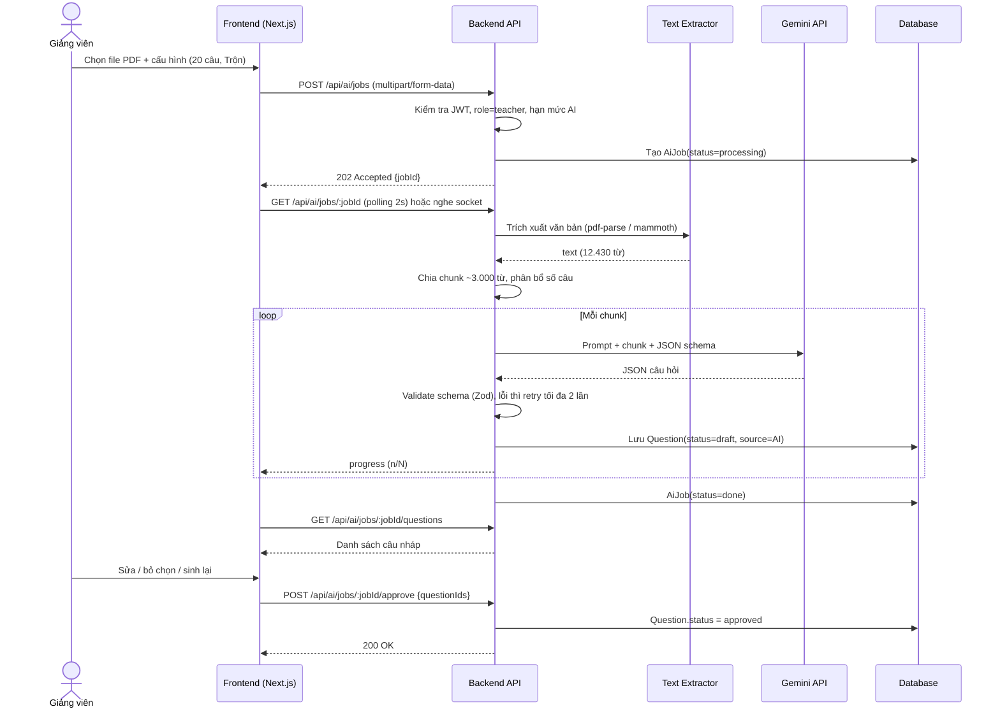

**Mẫu prompt gửi AI (rút gọn):**
```text
Bạn là chuyên gia ra đề thi đại học. Dựa CHỈ trên tài liệu dưới đây, tạo {n} câu hỏi trắc nghiệm
bằng {ngôn ngữ}, độ khó {difficulty}, loại {types}. Mỗi câu có 4 phương án, phương án nhiễu hợp lý,
không dùng "Tất cả đều đúng". Trả về DUY NHẤT JSON theo schema:
[{ "content": string, "type": "single"|"multiple", "options": [string x4],
   "correct": [index...], "explanation": string, "difficulty": "easy"|"medium"|"hard",
   "sourcePage": number|null }]
TÀI LIỆU:
"""{chunk}"""
```

### 14.2. Sinh viên vào phòng bằng PIN và bắt đầu làm bài (đồng bộ đồng hồ)

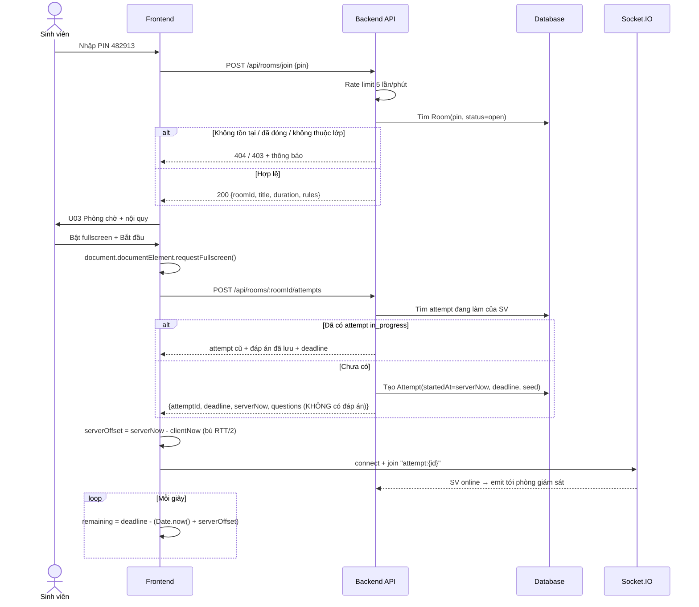

### 14.3. Autosave đáp án & khôi phục khi mất mạng

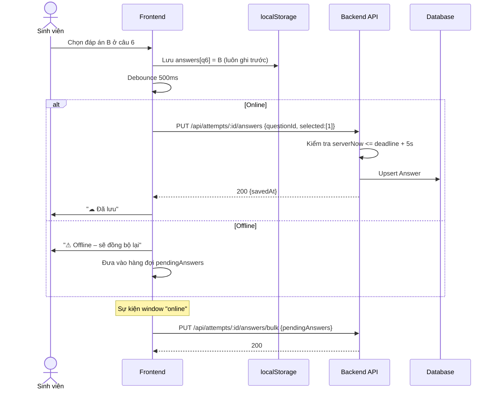

### 14.4. Phát hiện gian lận & cảnh báo realtime ⭐

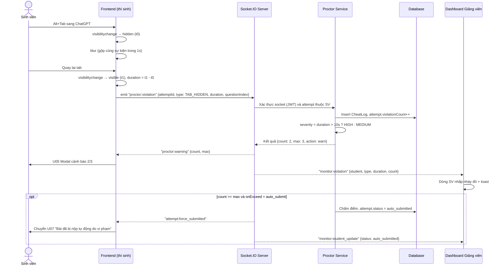

> [!NOTE]
> Nếu socket bị ngắt, sự kiện vi phạm được **đệm trong localStorage** và gửi lại qua `POST /api/attempts/:id/violations` khi kết nối lại — thí sinh không thể "né" giám sát bằng cách tắt mạng.

**Mã giả phía client (Proctor Hook):**
```typescript
// useProctor.ts – React custom hook (Next.js Client Component)
useEffect(() => {
  let hiddenAt = null;
  let lastReport = 0;

  const report = (type, extra = {}) => {
    const now = Date.now();
    if (now - lastReport < 1000) return;          // BR-06: gộp sự kiện trong 1 giây
    lastReport = now;
    socket.emit('proctor:violation', { attemptId, type, at: now + serverOffset, ...extra });
  };

  const onVisibility = () => {
    if (document.visibilityState === 'hidden') hiddenAt = Date.now();
    else if (hiddenAt) {
      report('TAB_HIDDEN', { duration: Date.now() - hiddenAt });
      hiddenAt = null;
    }
  };
  const onFullscreen = () => { if (!document.fullscreenElement) report('EXIT_FULLSCREEN'); };
  const onBlur = () => report('WINDOW_BLUR');
  const block = (e) => { e.preventDefault(); report(e.type.toUpperCase()); };  // COPY, PASTE, CONTEXTMENU
  const onKey = (e) => {
    const banned = e.key === 'F12' || e.key === 'PrintScreen' ||
      (e.ctrlKey && ['c', 'v', 'x', 'u', 'p', 's'].includes(e.key.toLowerCase())) ||
      (e.ctrlKey && e.shiftKey && e.key.toLowerCase() === 'i');
    if (banned) { e.preventDefault(); report('BLOCKED_SHORTCUT', { key: e.key }); }
  };

  document.addEventListener('visibilitychange', onVisibility);
  document.addEventListener('fullscreenchange', onFullscreen);
  window.addEventListener('blur', onBlur);
  ['copy', 'cut', 'paste', 'contextmenu'].forEach(ev => document.addEventListener(ev, block));
  document.addEventListener('keydown', onKey);

  return () => { /* removeEventListener tương ứng */ };
}, [attemptId]);
```

### 14.5. Nộp bài, tự nộp khi hết giờ & chấm điểm

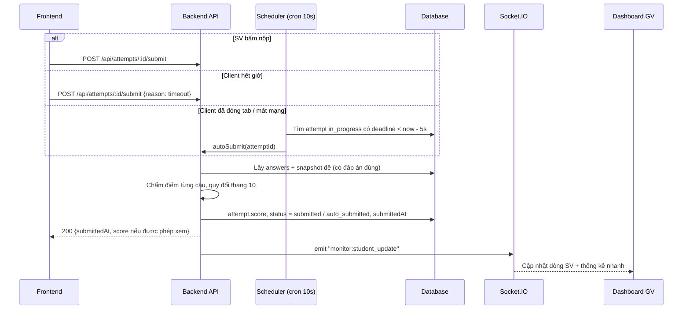

### 14.6. Giảng viên giám sát & can thiệp

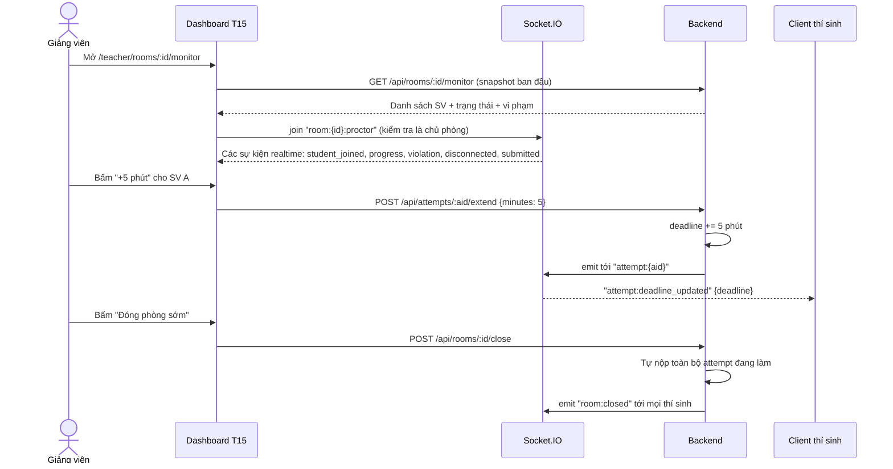

---

## 15. SƠ ĐỒ TRẠNG THÁI

### 15.1. Vòng đời Phòng thi (Room)

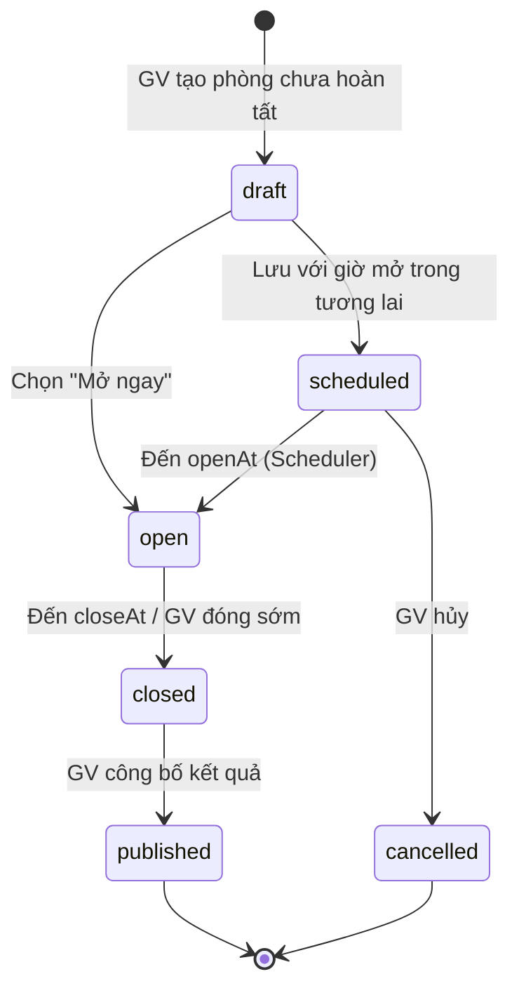

### 15.2. Vòng đời Lượt làm bài (Attempt)

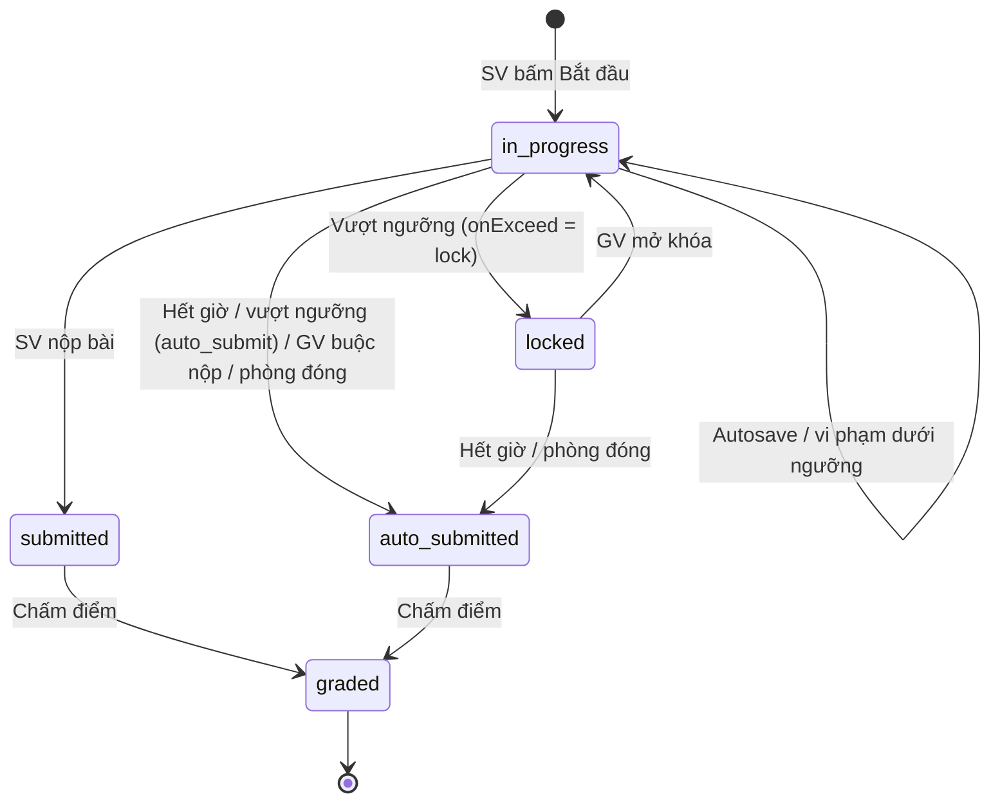

### 15.3. Trạng thái Câu hỏi (Question)

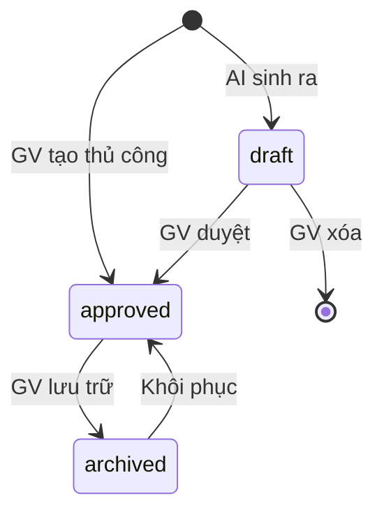

### 15.4. Trạng thái kết nối thí sinh trên Dashboard

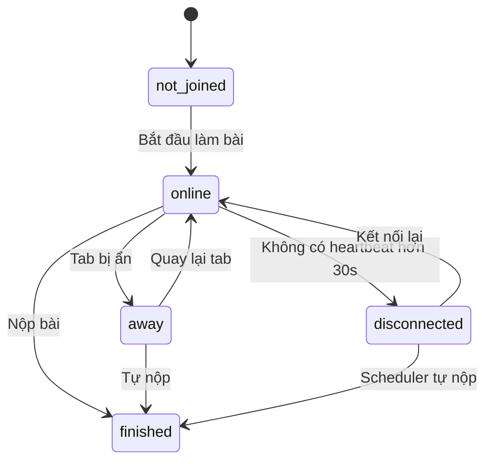

---

## 16. THIẾT KẾ CƠ SỞ DỮ LIỆU (ERD)

```mermaid
erDiagram
    USER ||--o{ CLASS : "giảng dạy"
    USER ||--o{ CLASS_MEMBER : "tham gia"
    CLASS ||--o{ CLASS_MEMBER : "gồm"
    USER ||--o{ QUESTION : "sở hữu"
    USER ||--o{ AI_JOB : "tạo"
    AI_JOB ||--o{ QUESTION : "sinh ra"
    QUESTION ||--|{ QUESTION_OPTION : "có"
    QUESTION }o--o{ TAG : "gắn"
    USER ||--o{ EXAM : "tạo"
    EXAM ||--|{ EXAM_QUESTION : "gồm"
    QUESTION ||--o{ EXAM_QUESTION : "xuất hiện trong"
    EXAM ||--o{ ROOM : "được dùng trong"
    CLASS |o--o{ ROOM : "dành cho"
    ROOM ||--o{ ATTEMPT : "có"
    USER ||--o{ ATTEMPT : "làm"
    ATTEMPT ||--o{ ANSWER : "chứa"
    ATTEMPT ||--o{ CHEAT_LOG : "ghi nhận"
    USER ||--o{ REFRESH_TOKEN : "có"

    USER {
        int id PK
        string email UK
        string password_hash
        string full_name
        string student_code
        enum role "student|teacher|admin"
        enum status "active|pending|locked"
        datetime created_at
    }
    CLASS {
        int id PK
        int teacher_id FK
        string name
        string course_code
        string semester
        string join_code UK
    }
    CLASS_MEMBER {
        int class_id PK
        int student_id PK
        datetime joined_at
    }
    AI_JOB {
        int id PK
        int teacher_id FK
        string file_name
        int word_count
        json config
        enum status "processing|done|failed"
        int generated_count
        string error
        datetime created_at
    }
    QUESTION {
        int id PK
        int owner_id FK
        int ai_job_id FK
        text content
        enum type "single|multiple"
        enum difficulty "easy|medium|hard"
        text explanation
        enum source "manual|ai"
        enum status "draft|approved|archived"
        int source_page
    }
    QUESTION_OPTION {
        int id PK
        int question_id FK
        text content
        boolean is_correct
        int order_index
    }
    TAG {
        int id PK
        string name UK
    }
    EXAM {
        int id PK
        int owner_id FK
        string title
        text description
        decimal total_points
        datetime created_at
    }
    EXAM_QUESTION {
        int exam_id PK
        int question_id PK
        int order_index
        decimal points
    }
    ROOM {
        int id PK
        int exam_id FK
        int class_id FK
        int owner_id FK
        string title
        char pin "6 chữ số"
        int duration_minutes
        datetime open_at
        datetime close_at
        enum status "draft|scheduled|open|closed|published|cancelled"
        json exam_snapshot
        json proctor_config
        boolean shuffle_questions
        boolean shuffle_options
        enum result_visibility "none|score|full"
    }
    ATTEMPT {
        int id PK
        int room_id FK
        int student_id FK
        datetime started_at
        datetime deadline
        datetime submitted_at
        enum status "in_progress|locked|submitted|auto_submitted|graded"
        int violation_count
        decimal score
        int correct_count
        int shuffle_seed
        string ip
        string user_agent
    }
    ANSWER {
        int attempt_id PK
        int question_id PK
        json selected_options
        boolean is_correct
        decimal points_earned
        datetime saved_at
    }
    CHEAT_LOG {
        int id PK
        int attempt_id FK
        enum type "TAB_HIDDEN|WINDOW_BLUR|EXIT_FULLSCREEN|COPY|PASTE|CONTEXTMENU|BLOCKED_SHORTCUT|MULTI_SESSION|DISCONNECT"
        int duration_ms
        int question_index
        enum severity "low|medium|high"
        datetime occurred_at
    }
    REFRESH_TOKEN {
        int id PK
        int user_id FK
        string token_hash
        datetime expires_at
        boolean revoked
    }
```

**Ghi chú thiết kế:**
- `ROOM.exam_snapshot` lưu bản sao đề (câu hỏi + đáp án) tại thời điểm tạo phòng → GV sửa ngân hàng câu hỏi không làm sai kết quả phòng cũ (BR-10).
- `ROOM.proctor_config` (JSON): `{ requireFullscreen, detectTab, blockCopy, blockShortcut, maxViolations, onExceed }`.
- Index quan trọng: `ROOM(pin, status)`, `ATTEMPT(room_id, student_id)` UNIQUE, `CHEAT_LOG(attempt_id, occurred_at)`, `ATTEMPT(status, deadline)` (cho Scheduler).

---

## 17. THIẾT KẾ API & SOCKET EVENTS

### 17.1. REST API

> Base URL: `/api` · Xác thực: `Authorization: Bearer <accessToken>` · Định dạng: JSON

| Nhóm | Method | Endpoint | Mô tả | Role |
|---|---|---|---|---|
| **Auth** | POST | `/auth/register` | Đăng ký | Guest |
| | POST | `/auth/login` | Đăng nhập | Guest |
| | POST | `/auth/refresh` | Cấp lại access token | Đã đăng nhập |
| | POST | `/auth/logout` | Đăng xuất | Đã đăng nhập |
| | POST | `/auth/forgot-password` · `/auth/reset-password` | Quên / đặt lại mật khẩu | Guest |
| | GET · PUT | `/users/me` | Xem / cập nhật hồ sơ | Đã đăng nhập |
| **Class** | GET · POST | `/classes` | Danh sách / tạo lớp | Teacher |
| | GET · PUT · DELETE | `/classes/:id` | Chi tiết / sửa / xóa | Teacher |
| | POST | `/classes/join` | SV vào lớp bằng mã | Student |
| | DELETE | `/classes/:id/members/:studentId` | Xóa SV khỏi lớp | Teacher |
| **Question** | GET | `/questions?search=&tag=&difficulty=&source=&page=&limit=` | Danh sách, lọc, phân trang | Teacher |
| | POST | `/questions` | Thêm | Teacher |
| | GET · PUT · DELETE | `/questions/:id` | Chi tiết / sửa / xóa | Teacher |
| **AI** | POST | `/ai/jobs` | Upload file + cấu hình, tạo job | Teacher |
| | GET | `/ai/jobs/:id` | Trạng thái / tiến độ | Teacher |
| | GET | `/ai/jobs/:id/questions` | Danh sách câu nháp | Teacher |
| | POST | `/ai/jobs/:id/questions/:qid/regenerate` | Sinh lại 1 câu | Teacher |
| | POST | `/ai/jobs/:id/approve` | Duyệt các câu đã chọn | Teacher |
| **Exam** | GET · POST | `/exams` | Danh sách / tạo đề | Teacher |
| | GET · PUT · DELETE | `/exams/:id` | Chi tiết / sửa / xóa | Teacher |
| | POST | `/exams/:id/duplicate` | Nhân bản | Teacher |
| | POST | `/exams/random` | Tạo đề theo ma trận | Teacher |
| **Room** | GET · POST | `/rooms` | Danh sách / tạo phòng | Teacher |
| | GET · PUT | `/rooms/:id` | Chi tiết / sửa cấu hình | Teacher |
| | POST | `/rooms/:id/open` · `/close` · `/extend` · `/publish` | Điều khiển phòng | Teacher |
| | GET | `/rooms/:id/monitor` | Snapshot giám sát | Teacher |
| | GET | `/rooms/:id/results` | Bảng điểm + thống kê + phổ điểm | Teacher |
| | GET | `/rooms/:id/results/export` | Xuất Excel | Teacher |
| | POST | `/rooms/join` | Nhập PIN | Student |
| **Attempt** | POST | `/rooms/:id/attempts` | Bắt đầu / tiếp tục bài làm | Student |
| | GET | `/attempts/:id` | Lấy bài làm (khôi phục) | Student (chủ) |
| | PUT | `/attempts/:id/answers` | Autosave 1 câu | Student (chủ) |
| | PUT | `/attempts/:id/answers/bulk` | Đồng bộ nhiều câu (sau offline) | Student (chủ) |
| | POST | `/attempts/:id/violations` | Gửi bù vi phạm (fallback khi mất socket) | Student (chủ) |
| | POST | `/attempts/:id/submit` | Nộp bài | Student (chủ) |
| | GET | `/attempts/:id/result` | Xem kết quả | Student (chủ) / Teacher |
| | POST | `/attempts/:id/unlock` · `/extend` · `/force-submit` | Can thiệp | Teacher |
| | GET | `/me/attempts` | Lịch sử thi | Student |
| **Admin** | GET | `/admin/users?role=&status=&search=&page=` | Danh sách người dùng | Admin |
| | PATCH | `/admin/users/:id` | Đổi vai trò / khóa / duyệt | Admin |
| | GET | `/admin/stats` | Thống kê hệ thống | Admin |
| | GET · PUT | `/admin/settings` | Cấu hình | Admin |
| **Util** | GET | `/time` | Trả `serverNow` để đồng bộ đồng hồ | Tất cả |

**Ví dụ response khi bắt đầu bài thi (không chứa đáp án):**
```json
{
  "attemptId": 812,
  "serverNow": "2026-11-09T01:00:12.120Z",
  "deadline": "2026-11-09T01:15:12.120Z",
  "violationCount": 0,
  "maxViolations": 3,
  "questions": [
    { "id": 31, "type": "single", "content": "Phương thức nào...", "options": [
      { "id": 121, "content": "response.text()" },
      { "id": 122, "content": "response.json()" }
    ] }
  ],
  "answers": { "31": [122] }
}
```

### 17.2. Socket.IO Events

| Hướng | Event | Payload | Mô tả |
|---|---|---|---|
| Client SV → Server | `attempt:join` | `{attemptId}` | Vào kênh bài thi của mình |
| Client SV → Server | `proctor:violation` | `{attemptId, type, duration, questionIndex, at}` | Báo vi phạm |
| Client SV → Server | `proctor:heartbeat` | `{attemptId, answered, currentIndex}` | 15s/lần, kèm tiến độ |
| Server → Client SV | `proctor:warning` | `{count, max, message}` | Hiển thị modal cảnh báo |
| Server → Client SV | `attempt:locked` · `attempt:unlocked` | `{reason}` | Khóa / mở khóa bài |
| Server → Client SV | `attempt:force_submitted` | `{reason}` | Bị nộp bài |
| Server → Client SV | `attempt:deadline_updated` | `{deadline}` | GV gia hạn |
| Server → Client SV | `room:announcement` · `room:closed` | `{message}` | Thông báo / đóng phòng |
| Client GV → Server | `monitor:join` | `{roomId}` | Vào kênh giám sát |
| Server → Client GV | `monitor:student_joined` | `{student, attemptId}` | SV bắt đầu làm |
| Server → Client GV | `monitor:progress` | `{attemptId, answered}` | Tiến độ |
| Server → Client GV | `monitor:violation` | `{attemptId, student, type, duration, severity, count}` | Vi phạm mới |
| Server → Client GV | `monitor:student_update` | `{attemptId, status}` | Đổi trạng thái (nộp, khóa, mất kết nối) |

**Socket rooms:** `attempt:{attemptId}` (1 thí sinh) · `room:{roomId}:students` (toàn bộ thí sinh) · `room:{roomId}:proctor` (giảng viên).

---

## 18. KIẾN TRÚC HỆ THỐNG & CÔNG NGHỆ

### 18.1. Sơ đồ kiến trúc

```mermaid
flowchart LR
    subgraph CLIENT["Frontend (Next.js)"]
        FE["Next.js (App Router, TypeScript) · Tailwind CSS · Axios · Socket.IO Client · Chart.js"]
    end

    subgraph SERVER["Backend (NestJS)"]
        API["NestJS REST API Controllers"]
        MW["Guards, Interceptors, Pipes: JWT, Roles/RBAC, Rate limit (Throttler), Helmet, Validation"]
        SOCK["NestJS WebSockets Gateway (Socket.IO)"]
        SVC["Modules & Services: Auth, Users, Classes, Questions, AI, Exams, Rooms, Attempts, Proctor, Reports"]
        CRON["Task Scheduling (@nestjs/schedule): mở/đóng phòng, tự nộp bài"]
        PARSER["pdf-parse · mammoth"]
    end

    DB[("Database: PostgreSQL (Prisma / TypeORM) hoặc MongoDB (Mongoose)")]
    CACHE[("Redis (tùy chọn): socket adapter, rate limit, cache")]
    FILE[("Lưu file: local / Cloudinary")]
    GEM["Google Gemini API"]

    FE -- "HTTPS JSON" --> API
    FE <-- "WebSocket" --> SOCK
    API --> MW --> SVC
    SOCK --> SVC
    CRON --> SVC
    SVC --> PARSER
    SVC --> DB
    SVC --> CACHE
    SVC --> FILE
    SVC -- "HTTPS + API key" --> GEM
```

### 18.2. Công nghệ đề xuất

| Tầng | Công nghệ | Lý do / Liên hệ bài giảng |
|---|---|---|
| Frontend | Next.js (App Router, TypeScript, React 19) | Lec 6 – React / Next.js Framework hiện đại |
| UI | Tailwind CSS, Lucide React / Shadcn UI | Lec 3 – CSS |
| Gọi API | Axios / Fetch API (interceptor tự động gắn JWT, auto-refresh token) | Lec 7 – Web API |
| Realtime | Socket.IO Client | Giám sát phòng thi realtime |
| Biểu đồ | Chart.js / Recharts | Phổ điểm & phân tích câu hỏi |
| Backend | NestJS (Node.js framework trên TypeScript, kiến trúc Module/Service/Controller) | Lec 8 – Backend chuyên nghiệp, Clean Architecture |
| Realtime Gateway | NestJS WebSockets Gateway (`@nestjs/websockets`, Socket.IO) | Giám sát realtime thời gian thực |
| ORM / DB | Prisma / TypeORM + PostgreSQL *hoặc* Mongoose + MongoDB | Quản lý dữ liệu quan hệ, type-safety |
| Xác thực & Phân quyền | Passport-JWT, Guards (`AuthGuard`, `RolesGuard`), bcrypt, cookie | Lec 9 – Web Security |
| Bảo mật | Helmet, `@nestjs/throttler` (rate limit), cors, `class-validator`, DOMPurify | Lec 9 – Web Security |
| AI | `@google/generative-ai` (Gemini API) | Điểm nhấn đề tài |
| Xử lý file | Multer, `pdf-parse`, `mammoth` | Upload và trích xuất slide bài giảng |
| Lập lịch | `@nestjs/schedule` (Cron jobs) | Tự nộp bài, tự động mở/đóng phòng theo lịch |
| Xuất file | `exceljs` | Xuất bảng điểm và danh sách vi phạm |
| Triển khai | Vercel (Frontend) · Render/Railway/Docker (Backend) · Supabase/Neon/Atlas (DB) | Lec 10 – Deployment |
| Quản lý mã | GitHub, Git Flow (nhánh tính năng, PR review) | Làm việc nhóm |

### 18.3. Cấu trúc thư mục đề xuất

```text
quizguard/
├── frontend/                    # Next.js (App Router, TypeScript)
│   ├── src/
│   │   ├── app/                 # App Router (pages, layouts, route handlers)
│   │   │   ├── (auth)/          # login, register, forgot-password
│   │   │   ├── (dashboard)/     # Layouts có sidebar cho từng role
│   │   │   │   ├── teacher/     # dashboard, questions, ai-generate, exams, rooms, monitor, results
│   │   │   │   ├── student/     # dashboard, join, history
│   │   │   │   └── admin/       # users, settings
│   │   │   ├── exam/            # [roomId]/attempt (giao diện làm bài thi fullscreen)
│   │   │   ├── layout.tsx       # Root layout
│   │   │   └── page.tsx         # Landing page
│   │   ├── components/          # Reusable components (Button, Modal, Timer, QuestionCard...)
│   │   ├── hooks/               # useAuth, useSocket, useProctor, useServerTimer, useAutosave
│   │   ├── services/            # API client (axiosInstance, authService, roomService...)
│   │   ├── types/               # TypeScript interfaces, DTOs
│   │   └── lib/                 # utils, socket.ts
│   ├── package.json
│   └── tailwind.config.ts
└── backend/                     # NestJS (TypeScript)
    ├── src/
    │   ├── common/              # decorators, filters, guards, interceptors, pipes
    │   ├── config/              # env configuration, database config
    │   ├── modules/
    │   │   ├── auth/            # AuthModule (controller, service, jwt.strategy, guards)
    │   │   ├── users/           # UsersModule
    │   │   ├── classes/         # ClassesModule
    │   │   ├── questions/       # QuestionsModule
    │   │   ├── ai/              # AiModule (Gemini service, document parser)
    │   │   ├── exams/           # ExamsModule
    │   │   ├── rooms/           # RoomsModule
    │   │   ├── attempts/        # AttemptsModule (auto-submit logic, grading)
    │   │   ├── proctor/         # ProctorModule + ProctorGateway (WebSockets)
    │   │   └── reports/         # ReportsModule (analytics, excel export)
    │   ├── jobs/                # Task scheduler (auto-submit cron, room closer)
    │   ├── app.module.ts
    │   └── main.ts
    ├── test/
    ├── package.json
    └── tsconfig.json
```

---

## 19. PHÂN CÔNG & LỘ TRÌNH TRIỂN KHAI

### 19.1. Phân công 5 thành viên

| TV | Vai trò | Phụ trách chính (FE + BE) | Màn hình |
|---|---|---|---|
| **TV1** | Trưởng nhóm · Auth & Admin | Setup repo, kiến trúc, JWT/refresh, RBAC, quản trị người dùng, duyệt GV, deploy | S01–S06, A01–A04 |
| **TV2** | Ngân hàng câu hỏi & AI | CRUD câu hỏi, tag, lọc/phân trang; upload + trích xuất + prompt + validate + duyệt | T04–T08 |
| **TV3** | Đề thi & Phòng thi | Trình tạo đề, ma trận, phòng thi PIN, cấu hình, chiếu PIN/QR, Scheduler mở/đóng | T09–T14, T02–T03 |
| **TV4** | Làm bài & Chống gian lận | Lobby, màn hình làm bài, đồng hồ server, autosave/offline, `useProctor`, modal cảnh báo, nộp bài | U02–U07 |
| **TV5** | Giám sát realtime & Báo cáo | Socket.IO server/client, dashboard giám sát, can thiệp, chấm điểm, phổ điểm, phân tích câu hỏi, xuất Excel | T15–T18, U08–U09 |

### 19.2. Kế hoạch theo tuần

| Tuần | Mục tiêu | Sản phẩm bàn giao |
|---|---|---|
| 1 | Phân tích, thiết kế, setup | Tài liệu này, ERD, Figma/wireframe, repo + template FE/BE |
| 2 | Auth + layout + CRUD câu hỏi | Đăng nhập theo role, T04/T05 chạy được |
| 3 | Đề thi + Lớp học | T09–T10, T02–T03 |
| 4 | AI sinh câu hỏi | T06–T08 sinh được câu hỏi từ PDF |
| 5 | Phòng thi PIN + làm bài cơ bản | T13–T14, U02–U04, đồng hồ server, nộp bài |
| 6 | Autosave, khôi phục, chống gian lận | `useProctor`, CheatLog, modal cảnh báo |
| 7 | Socket giám sát realtime | T15–T16 hoạt động end-to-end |
| 8 | Chấm điểm + phổ điểm + Admin → **MVP** | T17–T18, U08, A01–A03 |
| 9 | SHOULD features + bảo mật + test tải | Rate limit, sanitize, test 50+ người |
| 10 | Deploy + báo cáo + slide + video demo | URL public, báo cáo, slide bảo vệ |

---

## 20. RỦI RO & PHƯƠNG ÁN XỬ LÝ

| # | Rủi ro | Mức độ | Phương án |
|---|---|:---:|---|
| R1 | AI trả câu hỏi sai kiến thức / sai đáp án | Cao | Bắt buộc GV duyệt (BR-11); hiển thị trang nguồn; tự kiểm tra chất lượng cơ bản |
| R2 | AI trả JSON lỗi định dạng | TB | Dùng chế độ `responseMimeType: application/json` + schema, validate Zod, retry |
| R3 | Chi phí / hạn mức API AI | TB | Dùng gói miễn phí Gemini, giới hạn lượt/ngày, cache kết quả theo hash file |
| R4 | SV dùng thiết bị thứ 2 (điện thoại) để tra cứu | Cao | Thừa nhận giới hạn (không dùng webcam); giảm thiểu bằng xáo trộn câu/đáp án + thời gian ngắn |
| R5 | Báo động giả (thông báo hệ thống, pop-up làm mất focus) | TB | Gộp sự kiện, phân mức độ theo thời lượng, GV xem timeline trước khi kết luận |
| R6 | Trình duyệt/thiết bị không hỗ trợ Fullscreen (iOS Safari) | TB | Kiểm tra ở phòng chờ, cảnh báo dùng laptop; GV có thể tắt yêu cầu fullscreen |
| R7 | Nhiều kết nối socket cùng lúc gây quá tải | TB | Throttle heartbeat, gộp cập nhật dashboard 1s/lần; Redis adapter nếu cần |
| R8 | Sai lệch đồng hồ giữa client và server | Thấp | Tính `serverOffset`, đồng bộ lại 60s/lần, server là nguồn chân lý |
| R9 | Lộ đáp án qua API / DevTools | Cao | Không gửi `is_correct` xuống client, chấm ở server, kiểm tra quyền sở hữu attempt |
| R10 | Thành viên trễ tiến độ | TB | Họp ngắn 2 lần/tuần, ưu tiên MUST, review PR chéo |

---

## 21. KỊCH BẢN DEMO BẢO VỆ (≈ 10 PHÚT)

| Bước | Thời gian | Người thao tác | Nội dung trình diễn |
|---|---|---|---|
| 1 | 1' | Thuyết trình | Bối cảnh → vấn đề → giải pháp (mục 1–5) |
| 2 | 2' | GV (máy 1) | Upload **chính slide `lec_7-web_api.pdf` của môn học** → AI sinh 10 câu → sửa 1 câu → lưu |
| 3 | 1' | GV | Tạo đề 10 câu → tạo phòng 5 phút, ngưỡng 3 vi phạm, tự nộp → chiếu mã PIN lên máy chiếu |
| 4 | 1' | **Giảng viên chấm + các bạn trong lớp** | Mời mọi người dùng laptop/điện thoại nhập PIN vào thi thử |
| 5 | 2' | SV (máy 2) | Làm bài → **chuyển tab** → modal cảnh báo 1/3 → thoát fullscreen 2/3 → F5 trang vẫn còn đáp án & thời gian → chuyển tab lần 3 → **bị tự nộp** |
| 6 | 1' | GV (máy 1) | Dashboard giám sát: dòng SV nhấp nháy đỏ, timeline vi phạm, cộng giờ cho 1 SV khác |
| 7 | 1' | GV | Đóng phòng → **phổ điểm, thống kê, câu hỏi khó nhất** → xuất Excel |
| 8 | 1' | Thuyết trình | Kiến trúc, bảo mật (không lộ đáp án, JWT, rate limit), hướng phát triển |

> [!TIP]
> Chuẩn bị sẵn **video quay màn hình dự phòng** cho bước 2 (AI) và bước 5 phòng khi mạng hội trường yếu hoặc API AI chậm.

---

## PHỤ LỤC – HƯỚNG PHÁT TRIỂN
- Giám sát webcam tùy chọn (phát hiện vắng mặt / nhiều khuôn mặt bằng TensorFlow.js chạy trên client).
- Câu hỏi tự luận ngắn chấm bằng AI có thang tiêu chí (rubric).
- Ngân hàng câu hỏi dùng chung theo học phần giữa các giảng viên.
- Tích hợp đăng nhập SSO tài khoản trường, đồng bộ danh sách lớp.
- Phân tích học tập (learning analytics): theo dõi tiến bộ của SV qua nhiều bài quiz.
