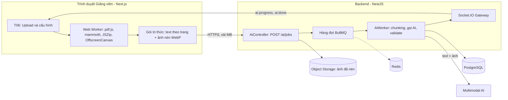
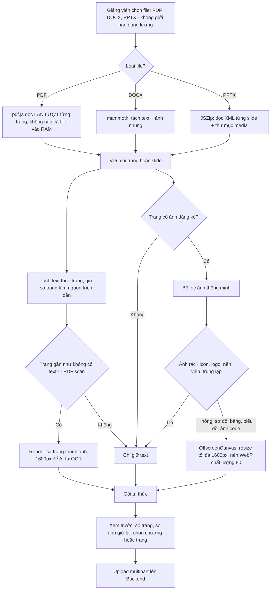
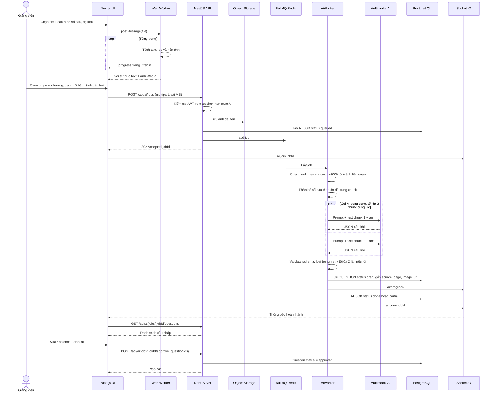
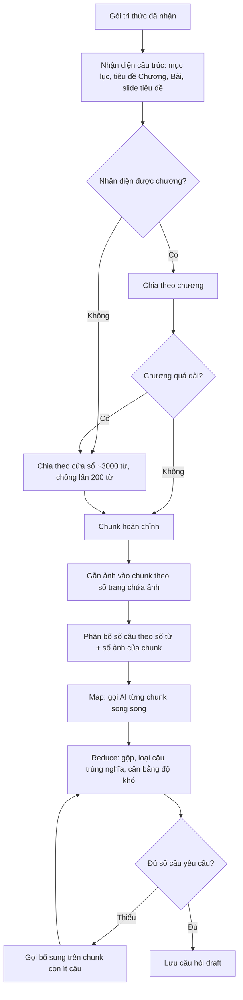

# Thiết kế chi tiết: Upload & Xử lý tài liệu để AI sinh câu hỏi

> Tài liệu kỹ thuật cho module **AI** (UC12) của QuizGuard. Phần yêu cầu và thiết kế chung xem tại [Overview.md](../Overview.md):
> UC12 (mục 6.3) · FR-AI (mục 7.4) · NFR-03b (mục 8) · Sequence tổng quan (mục 14.1) · Vòng đời AI Job (mục 15.5) · ERD `AI_JOB`, `QUESTION` (mục 16) · Socket `ai:*` (mục 17.2) · Rủi ro R11, R12 (mục 20).

---

## MỤC LỤC

1. [Bài toán & mục tiêu](#1-bài-toán--mục-tiêu)
2. [Kiến trúc tổng thể](#2-kiến-trúc-tổng-thể)
3. [Xử lý tại trình duyệt](#3-xử-lý-tại-trình-duyệt-client-side)
4. [Luồng xử lý end-to-end](#4-luồng-xử-lý-end-to-end)
5. [Chia đoạn (Chunking) cho tài liệu siêu dài](#5-chia-đoạn-chunking-cho-tài-liệu-siêu-dài)
6. [Prompt gửi AI](#6-prompt-gửi-ai)
7. [Xử lý lỗi & trường hợp đặc biệt](#7-xử-lý-lỗi--trường-hợp-đặc-biệt)
8. [API, dữ liệu & thư viện](#8-api-dữ-liệu--thư-viện)

---

## 1. Bài toán & mục tiêu

| Vấn đề | Nếu xử lý đơn giản (upload file gốc lên server) |
|---|---|
| Slide/giáo trình có thể nặng hàng trăm MB – vài GB (chủ yếu do ảnh, video độ phân giải cao) | Upload lâu, server tràn RAM, request timeout |
| Phần chữ thực tế chỉ vài trăm KB, nhưng **tri thức quan trọng nằm trong sơ đồ, bảng, biểu đồ, ảnh code** | Nếu bỏ ảnh để giảm dung lượng → AI bị hổng kiến thức |
| Tài liệu dài vượt giới hạn ngữ cảnh của AI | AI bỏ sót nội dung hoặc lỗi |

**Mục tiêu:**
- **Không giới hạn dung lượng** file giảng viên tải lên.
- **Không bỏ sót tri thức** trong hình ảnh.
- Server **không nạp file gốc vào RAM**, không timeout; giao diện không bị đơ.

**Ý tưởng cốt lõi:** Xử lý nặng ngay tại trình duyệt (Web Worker): tách chữ, lọc và nén ảnh quan trọng → chỉ gửi **gói tri thức nhẹ (vài MB)** lên server → server xử lý **bất đồng bộ** bằng hàng đợi → AI đa phương thức sinh câu hỏi → báo kết quả realtime.

---

## 2. Kiến trúc tổng thể



| Thành phần | Vai trò |
|---|---|
| **Web Worker (client)** | Đọc file cục bộ từng trang; file gốc không đi qua mạng; không làm đơ giao diện |
| **AiController** | Nhận gói tri thức, lưu ảnh, tạo `AI_JOB` (`queued`), trả `202 Accepted` ngay |
| **BullMQ + Redis** | Hàng đợi tác vụ nền, retry, giới hạn số job chạy đồng thời |
| **AiWorker** | Chia chunk, gọi AI song song, validate JSON, lưu câu hỏi `draft` |
| **Socket.IO Gateway** | Đẩy tiến độ và kết quả về giao diện giảng viên |
| **Object Storage** | Lưu ảnh sơ đồ đã nén để đính kèm vào câu hỏi |

---

## 3. Xử lý tại trình duyệt (Client-side)



### 3.1. Quy tắc lọc ảnh rác (Smart Filter)

| Quy tắc | Điều kiện loại bỏ | Lý do |
|---|---|---|
| Kích thước nhỏ | Cạnh dài < 150px | Icon, bullet, logo |
| Tỷ lệ bất thường | Rộng/cao > 8 hoặc < 1/8 | Thanh kẻ, viền trang trí |
| Lặp lại nhiều trang | Cùng hash ảnh xuất hiện ≥ 3 trang | Logo trường, header/footer template |
| Ảnh nền | Phủ > 90% trang và trang vẫn có nhiều text | Background slide |
| Đơn sắc | Độ lệch màu rất thấp | Khối màu trang trí |

### 3.2. Cấu trúc gói tri thức gửi lên server

```json
{
  "fileName": "lec_7-web_api.pdf",
  "pageCount": 120,
  "pages": [
    { "page": 1, "text": "Web API ...", "images": [] },
    { "page": 14, "text": "Luồng xác thực JWT ...", "images": ["img_14_0"] },
    { "page": 37, "text": "", "images": ["page_37_scan"] }
  ],
  "selectedRange": { "fromPage": 10, "toPage": 60 },
  "config": { "count": 20, "difficulty": "mixed", "types": ["single", "multiple"], "language": "vi" }
}
```
Các ảnh (`img_14_0`, `page_37_scan`, …) được gửi kèm dạng file WebP trong cùng request `multipart/form-data`.

### 3.3. Hiệu quả (ví dụ minh họa)

| Đầu vào | Dữ liệu thực gửi lên server |
|---|---|
| Slide PDF 1,2 GB, 120 trang, 300 ảnh 4K | Text ~400 KB + 45 ảnh sơ đồ × ~80 KB ≈ **4 MB** |
| Giáo trình DOCX 300 MB | Text ~1 MB + 30 ảnh ≈ **3,5 MB** |

---

## 4. Luồng xử lý end-to-end



---

## 5. Chia đoạn (Chunking) cho tài liệu siêu dài



**Công thức phân bổ số câu cho chunk thứ i** (mỗi ảnh quy đổi tương đương ~150 từ):

$$
n_i = \text{round}\left(N \times \frac{w_i + 150 \cdot img_i}{\sum_j \left(w_j + 150 \cdot img_j\right)}\right)
$$

Trong đó `N` là tổng số câu yêu cầu, `w_i` là số từ, `img_i` là số ảnh của chunk i. Phần dư do làm tròn cộng vào chunk lớn nhất.

---

## 6. Prompt gửi AI

```text
Bạn là chuyên gia ra đề thi đại học. Dựa CHỈ trên tài liệu dưới đây, tạo {n} câu hỏi trắc nghiệm
bằng {ngôn ngữ}, độ khó {difficulty}, loại {types}. Mỗi câu có 4 phương án, phương án nhiễu hợp lý,
không dùng "Tất cả đều đúng". Trả về DUY NHẤT JSON theo schema:
[{ "content": string, "type": "single"|"multiple", "options": [string x4],
   "correct": [index...], "explanation": string, "difficulty": "easy"|"medium"|"hard",
   "sourcePage": number|null, "imageRef": number|null }]
TÀI LIỆU:
"""{chunk}"""
HÌNH ẢNH ĐÍNH KÈM: {danh sách ảnh sơ đồ của chunk, kèm số trang}
Nếu câu hỏi dựa trên một hình, điền "imageRef" là chỉ số ảnh tương ứng.
```

- Bật chế độ trả JSON của AI (ví dụ `responseMimeType: application/json`) để giảm lỗi định dạng.
- Câu hỏi có `imageRef` sẽ được gắn `image_url` của ảnh tương ứng → sinh viên nhìn thấy sơ đồ khi làm bài.

---

## 7. Xử lý lỗi & trường hợp đặc biệt

| Tình huống | Cách xử lý |
|---|---|
| Máy GV yếu, file rất nặng | Worker xử lý từng trang rồi giải phóng bộ nhớ; hiển thị tiến độ; cho phép hủy |
| GV đóng tab khi đang xử lý ở trình duyệt | Chưa tạo job trên server → phải chọn lại file |
| GV đóng tab sau khi đã gửi lên server | Job vẫn chạy nền; mở lại T07 thấy trạng thái job |
| PDF scan, không có text | Render trang thành ảnh, AI tự OCR |
| AI trả JSON sai định dạng | Validate (`class-validator`/Zod), retry tối đa 2 lần mỗi chunk |
| AI lỗi một số chunk | Job `partial`, vẫn cho duyệt phần đã có |
| Vượt hạn mức gọi AI | Từ chối tạo job, báo số lượt còn lại |
| File có mật khẩu / hỏng | Báo lỗi ngay tại trình duyệt, không gửi lên server |

Vòng đời trạng thái của job (`queued → processing → done / partial / failed`): xem [Overview.md – mục 15.5](../Overview.md).

---

## 8. API, dữ liệu & thư viện

### 8.1. REST API

| Method | Endpoint | Mô tả |
|---|---|---|
| POST | `/api/ai/jobs` | Gửi gói tri thức (multipart) + cấu hình, trả `202 {jobId}` |
| GET | `/api/ai/jobs/:id` | Trạng thái, tiến độ (dự phòng khi mất socket) |
| GET | `/api/ai/jobs/:id/questions` | Danh sách câu nháp |
| POST | `/api/ai/jobs/:id/questions/:qid/regenerate` | Sinh lại 1 câu |
| POST | `/api/ai/jobs/:id/approve` | Duyệt các câu đã chọn |

### 8.2. Socket events

| Hướng | Event | Payload |
|---|---|---|
| Client → Server | `ai:join` | `{ jobId }` |
| Server → Client | `ai:progress` | `{ jobId, progress, doneChunks, totalChunks }` |
| Server → Client | `ai:done` | `{ jobId, status, generatedCount }` |

### 8.3. Dữ liệu (bổ sung vào ERD)

- `AI_JOB`: `status` ∈ {`queued`, `processing`, `done`, `partial`, `failed`}, `progress`, `page_count`, `image_count`, `total_chunks`, `done_chunks`, `generated_count`.
- `QUESTION`: `source_page`, `image_url`.

### 8.4. Thư viện

| Tầng | Thư viện |
|---|---|
| Frontend | `pdfjs-dist`, `mammoth`, `jszip`, Web Worker, `OffscreenCanvas` |
| Backend | `@nestjs/bullmq`, `bullmq`, `ioredis`, `multer`, `class-validator` |
| Hạ tầng | Redis (Upstash miễn phí), Object Storage (Cloudinary / Supabase Storage) |
